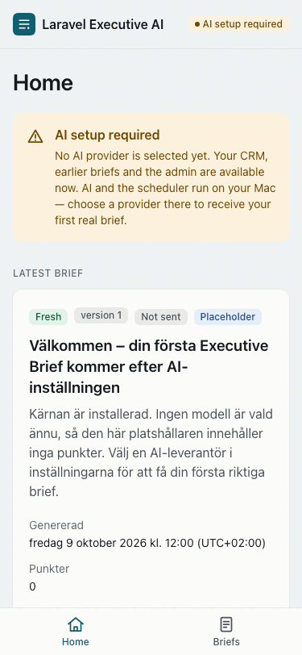
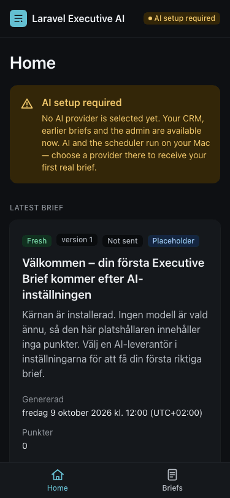
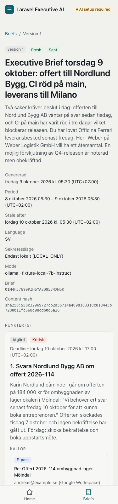
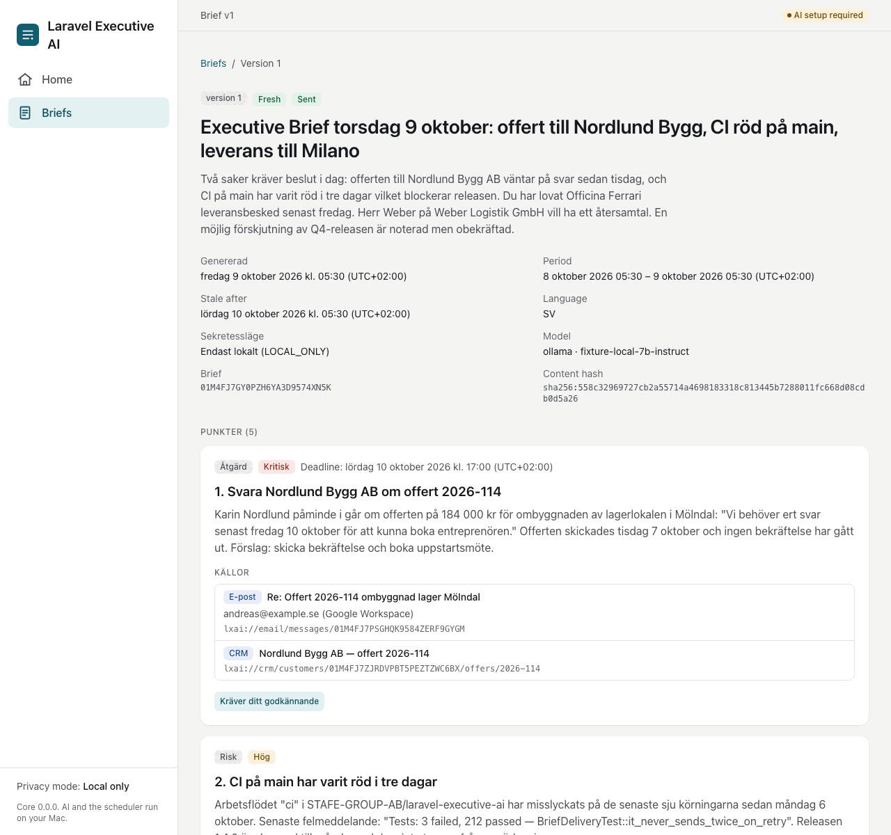
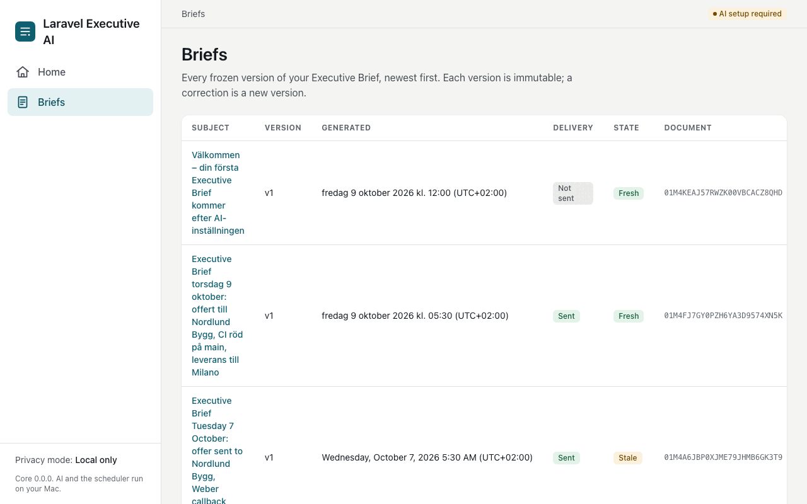

# PWA app shell (S1-04)

**Status:** Sprint 1 · **Workstream:** C (TALL/PWA design) · **Issue:** #32
**Binding references:** blueprint §1.2 (installable PWA, cache rule, "AI never runs on the phone"),
§1.3 (one brief, identical everywhere), §4.2 (sources or uncertainty marker on every item), §14
(accessibility, Playwright allowed in tests only); ADR-006 D3 (two origins, service worker and
manifest rows); threat model T-21/T-22/A16; `design-system.md` (tokens, contrast gate).

## 1. What the shell is

The PWA is a server-rendered Laravel application that a browser can install. Every page is produced
by Blade on the Mac; the service worker exists only so the *chrome* (CSS, JS, icons, manifest, the
offline page) opens instantly and installs cleanly. Nothing that carries content, a session or a
secret is ever written to a client cache (§1.2). AI and the scheduler run on the Mac; no copy in the
UI may say otherwise, and `tests/Feature/Pwa/` greps every rendered page against a denylist of such
phrases (`Tests\Support\PwaFixtures::AI_ON_PHONE_DENYLIST`).

| Piece | File | Notes |
|---|---|---|
| Layout | `resources/views/layouts/app.blade.php` | Skip link, one `<main id="main">`, sidebar ≥ 1024 px, bottom tab bar below, safe-area insets (`pt-safe`, `pb-safe`, `pb-tabbar`), header with the AI state badge, approvals badge only when `pending_approvals > 0`, "Signed in as …", passkey status (`PasskeyAuthenticator::status()`), and the sign-out form posting to `route('logout')` (S1-02). |
| Head | `resources/views/partials/head.blade.php` | Viewport with `viewport-fit=cover`, two `theme-color` metas (light/dark canvas), Apple `apple-mobile-web-app-*` metas, manifest and icon links, Vite assets. |
| Pages | `resources/views/home/index.blade.php`, `resources/views/briefs/{index,show}.blade.php`, `resources/views/offline.blade.php` | `/home`, `/briefs`, `/briefs/{brief}`, `/offline`. |
| Components | `resources/views/components/` | `brief-item`, `badge`, `empty-state`, `ai-state-banner`, `ai-state-badge`, `brief-state-badge`, `nav-link`, `icon`, `brand-mark`. |
| Shell state | `App\Http\View\ShellState`, `ShellStateComposer`, `AiStateCopy` | `$shell` on every page: `ai_state`, `ai_provider`, `pending_approvals`, `privacy_mode`, read from the same bindings `/health/ready` uses (`AiReadiness`, `PendingApprovals`). |
| Brief page | `App\Briefs\Render\BriefPage` (over S1-03's `BriefParityPayload` and `BriefViewModel`), `BriefCatalog`, `BriefTime`, `ItemPresentation` | See §3. |
| Manifest | `public/manifest.webmanifest` | `start_url` `/home`, `scope` `/`, `display` `standalone`, colours mirrored from `tokens.css` (`background_color` = `--color-canvas` light, `theme_color` = `--color-accent`). |
| Icons | `public/icons/` | `icon.svg` (source), `icon-192/512.png` (`purpose: any`), `icon-maskable-192/512.png` (full-bleed, glyph inside the 80 % safe zone), `apple-touch-icon.png` (180×180). All under 3 KB. |
| Service worker | `resources/js/service-worker.js` → `public/sw.js` | Built by `vite build --config vite.sw.config.js` (part of `npm run build`), unminified so it can be audited; registered from `resources/js/app.js`. `public/sw.js` is a build artefact and git-ignored. |
| CSS | `resources/css/app.css` | Tokens only; focus-visible ring, skip link, `.card`, `.btn-primary/secondary`, safe-area utilities. No raw hex in Blade. |

There is no inline `<script>`, no inline `style=""` and no inline event handler anywhere in the
templates (asserted by `HomePageTest`), so the pages run unchanged under S1-02's strict
`Content-Security-Policy` (`App\Http\Middleware\SecurityHeaders`: `script-src 'self' 'nonce-…'`,
`connect-src 'self'`, `frame-ancestors 'none'`; A16). Livewire and Alpine are not loaded on these
pages yet: Sprint 1's pages are static server renders; when a page needs them, use `@livewireScripts`
(it picks up `Vite::cspNonce()`), never a CDN, and give any inline bootstrap the nonce.

Only loopback host names are trusted (`App\Http\Middleware\TrustLoopbackHosts`, prepended to the
global stack in `bootstrap/app.php`; ADR-006 D3): a request carrying any other `Host` is refused
before `ResolveRequestOrigin` derives the URL root from it (`tests/Feature/Pwa/TrustedHostsTest.php`,
threat model T-18). It is our own subclass because Laravel's stock `TrustHosts` disables itself in
the `local` environment the installed core runs in. The exact tailnet DNS name joins the list through
`config('remote.trusted_hosts')` with remote access (E4-1). Consequence for development: use
`php artisan serve` (127.0.0.1); a Herd `.test` domain is refused by design.

## 2. Routes

Registered in `routes/pwa.php`, required from `routes/web.php` after `routes/briefs.php` (S1-03)
and `routes/auth.php` (S1-02), so the `web` middleware group applies. The route names `home` and
`briefs` are the contract S1-02's login redirect (`redirectIntended(default: route('home'))`) and
`redirectUsersTo('/home')` rely on. `/` redirects to `/home`; a guest is sent on to `/login`.

| Route | Name | Middleware | Renders |
|---|---|---|---|
| `GET /home` | `home` | `auth` | Latest brief card (subject, `generated_at` in the brief's own offset, fresh/stale/error from `LatestBrief::state`), the AI state banner while `ai_state != ready`, pending approvals count, quick links. |
| `GET /briefs` | `briefs` | `auth` | Every version visible to the user, newest first: subject, version, `generated_at`, `delivery_state`, fresh/stale, document id. Wide table scrolls inside its own container. |
| `GET /briefs/{brief}` | `briefs.show` | `auth` + `BriefPolicy::view` | The full brief (§3). A brief outside the user's organizations is a 403 (same as the S1-03 preview routes); an unknown id is a 404. |
| `GET /briefs/{brief}/parity.json` | `briefs.parity` | `auth` + `BriefPolicy::view` | The parity payload the page was rendered from, as JCS canonical JSON (`Cache-Control: no-store`), for S1-10. |
| `GET /offline` | `offline` | `web` minus session, CSRF and queued cookies | The precached offline page. No `Set-Cookie`, no per-user state. |

`{brief}` is either a version row id (`briefs.id`, that exact version — what the version history
links to) or a document id (its newest version — what the mail's "Open the full brief" link,
`url('/briefs/{id}')`, and the menu bar's `latest_brief.id` carry). `BriefCatalog::resolve()` does
the lookup; the two are distinct ULIDs so there is no ambiguity. S1-03's preview routes
(`/briefs/{brief}/preview/mail|text`, `routes/briefs.php`) keep their implicit row-id binding.

Reading one brief is authorised by `App\Policies\BriefPolicy::view` (S1-03) via `Gate::authorize`.
Listing uses `App\Briefs\Render\BriefCatalog::visibleTo()` — the query form of the same rule:
briefs whose `organization_id` is one of the user's memberships. There is no admin bypass; a user
without a membership sees the empty states.

## 3. One brief, same fields everywhere

The page is built exactly like the mail (`brief-parity.md` §1 "payload-driven rendering, not
payload-extracted"): `BriefPage::fromBrief()` exports the document with `BriefDocumentMapper`, projects
it with `BriefParityPayload::fromDocument()` and hands that payload to the same
`BriefViewModel::build($payload, $locale)` the mail renders from. So the labels
(`lang/{sv,en,it,de}/brief.php`), the date wording (`BriefLocale`), the item numbering, the resolved
sources and the uncertainty line on the page are the mail's by construction, and what the page exports
at `/briefs/{brief}/parity.json` is the payload it was rendered from. The brief's own locale is used
for everything inside the article; the chrome around it (navigation, breadcrumbs, delivery and
fresh/stale badges) is the app locale.

The page carries the same data as attributes so a parity or E2E test can read values, not wording:

```html
<article data-brief data-brief-document-id="…" data-brief-version="1"
         data-brief-generated-at="2026-10-09T05:30:00+02:00" data-brief-content-hash="sha256:…">
  <ol data-brief-items>
    <li data-brief-item data-item-id="…" data-position="0" data-kind="action" data-priority="critical">
      … <li data-source-ref data-source-id="…" data-source-type="email"> …
      … <p data-uncertainty data-confidence="0.4"> …
```

Every item shows its `source_refs` (type, account label, title, uri) **or** its uncertainty marker
(reason and confidence) — both when both exist (§4.2); `BriefParityPayload` refuses a document with a
bare claim before anything renders. Items are rendered in document order; bodies are whole, never
truncated. The install-time placeholder (`provider: none`,
`trace_id: placeholder`) renders "Nothing yet"; an empty period renders "Nothing new" — neither is an
error (§4.2 "AI unavailable must not block reading the previous brief").

Dates are formatted by `BriefLocale::dateTime()` in the brief's language, and the RFC 3339 value sits
in `<time datetime>`; presentation may differ between surfaces, the value may not.

## 4. Service-worker cache policy

The worker is allow-list shaped: a response can only enter the cache through one function,
`putInShellCache()`, which re-checks the path against `SHELL_ALLOWLIST`, refuses anything under
`NEVER_CACHE`, and refuses any response that is not `ok`, not same-origin (`type !== "basic"`), carries
`Set-Cookie`, or says `Cache-Control: no-store`/`private`. Non-GET and cross-origin requests are never
handled at all. No IndexedDB, localStorage, push or background sync.

| List | Entries | Strategy |
|---|---|---|
| **Allow (app shell)** | `/build/` (Vite assets, read from `/build/manifest.json` at install), `/icons/`, `/manifest.webmanifest`, `/offline`, `/favicon.ico` | Cache-first, precached on install, old `lxai-shell-*` caches dropped on activate. |
| **Deny (never cached, never served from cache)** | `/briefs`, `/home`, `/login`, `/logout`, `/auth`, `/ipc`, `/health`, `/livewire`, `/api`, `/admin`, `/approvals`, `/assistant`, `/crm`, `/inbox`, `/integrations`, `/mcp`, `/automation`, `/sanctum`, `/up` | Network only. A navigation that fails offline gets the precached `/offline` page — never a cached brief, because there is none. |
| **Everything else** | | Network only, no cache read or write. |

The deny list is consulted before the allow list, so a future allow-list edit cannot leak a page.
The offline route is served without the session, CSRF and cookie middleware so its cached copy
carries no cookie and nothing per-user (`ManifestTest` asserts the response has no cookies).

**Audit.** `node --test 'packaging/fixtures/e2e/**/*.test.mjs'` (CI job `fixtures`) statically parses
the worker — the source always, the built `public/sw.js` when present — and fails if: any required
deny entry is missing; any allow entry is outside the shell set or overlaps a denied prefix; any
precache entry is outside the shell; `Cache.put` has more than one call site or lives outside
`putInShellCache()`; `Cache.add/addAll` appears; the `Set-Cookie`/`no-store`/`basic` guards or the
GET/same-origin guards are gone; or a storage API, `importScripts`, push or sync handler appears.
`tests/Feature/Pwa/ServiceWorkerTest.php` adds that `app.js` is the only registration and that the
build emits `public/sw.js`. ADR-006 D3 row "Service worker / manifest" is satisfied: identical files
on both origins, `start_url` `/home`, scope `/`.

## 5. Installing

**macOS Safari 17+.** Open the app, File → Add to Dock (or the Share button → Add to Dock). Safari
reads `manifest.webmanifest` for the name and icon; the Dock app opens at `/home` in standalone mode.

**macOS Chrome / Edge.** Open the app, click the install icon in the address bar (or ⋮ → Cast, save
and share → Install page as app). Chrome requires the manifest, a 192 and 512 icon and a registered
service worker with a fetch handler — all present.

**iPhone / iPad (Safari).** Open the app, Share → Add to Home Screen. iOS uses `apple-touch-icon.png`
and `apple-mobile-web-app-title` ("Executive AI"); the status bar follows `theme-color` and the
layout respects the safe areas. Remote access needs the ADR-006 tunnel (HTTPS); the installed app is
then bound to that origin.

**Local development.** Loopback is a secure context, so `http://127.0.0.1:<port>` registers the worker
and installs. After `npm run build` the worker caches the hashed assets listed in
`public/build/manifest.json`; during `npm run dev` the worker serves the last built shell, which is
fine for the Blade pages because they are network-only anyway. Regenerate the PNG icons from the SVG
sources with ImageMagick:

```sh
cd public/icons
for s in 192 512; do
  magick -background none -density 192 icon.svg -resize ${s}x${s} -strip PNG8:icon-$s.png
  magick -background none -density 192 icon-maskable.svg -resize ${s}x${s} -strip PNG8:icon-maskable-$s.png
done
magick -density 192 icon-maskable.svg -resize 180x180 -strip PNG8:apple-touch-icon.png
```

## 6. Responsive and accessible

Tested at 375 (iPhone), 768 (tablet) and 1280 (desktop) px: no horizontal body scroll — the only wide
element, the versions table, scrolls inside `overflow-x: auto`; long ids and URIs use `break-all`.
Every link, button and tab is at least 44 px tall (`min-h-touch`), the focus ring is the token ring on
`:focus-visible`, dark mode follows `prefers-color-scheme` through `tokens.css`, state is never colour
alone (every badge carries a word), and the brief is rendered with `lang` set to its own language so
screen readers switch voice. `node packaging/fixtures/design/contrast-check.mjs` stays at 70/70.

Rendered from the fixture pack (placeholder, `brief-stale`, `brief-canonical`; `ai_state`
`not_configured`), captured with headless Chromium:

| `/home`, 375 px, light | `/home`, 375 px, dark | `/briefs/{brief}`, 375 px |
|---|---|---|
|  |  |  |

| `/briefs/{brief}`, 1280 px | `/briefs`, 1280 px |
|---|---|
|  |  |

## 7. What later items add

- **S1-02** (merged) — `/login`, `/logout`, OTP-by-email sessions, the A16 header set. The layout
  posts its sign-out to `route('logout')`; S1-02's interim `/home` and `/briefs` placeholders were
  replaced by the pages here under the same names.
- **S1-03** (merged) — the mail and the page share `BriefParityPayload` and `BriefViewModel::build()`;
  the mail's CTA `url('/briefs/{document id}')` opens the newest version here. `/home` links to the
  mail preview when `briefs.previewMail` exists. Preview routes are network-only by the deny list.
- **S1-09** — the menu bar reads `latest_brief` from `/health/ready`; "Open PWA" should deep-link to
  `/briefs/{brief}` using the version row id, "Open full brief" to the same.
- **S1-10** — fetch `/briefs/{brief}/parity.json` (or call `BriefPage::parityJson()`) and compare it
  byte for byte with `RenderedBrief::parityJson()` and the Swift export; `BriefsPagesTest` already
  asserts it equals `tests/__snapshots__/brief-canonical.parity.json`. `data-brief-version`,
  `data-brief-generated-at` and `data-parity-hash` are on the article for the DOM side.
- **S1-11** — the "AI setup required" banner is `components/ai-state-banner.blade.php` with its
  wording in `App\Http\View\AiStateCopy`; "AI ready" exists on exactly one code path (the `Ready`
  case) and `ManifestTest` asserts it. S1-11 adds the "Select AI" affordance and the menu-bar half.
- **Sprint 2+** — `/assistant`, `/approvals`, `/crm/*`, Livewire/Alpine (nonce'd, bundled), push
  notifications (a separate worker concern, still never carrying brief text), user-approved
  offline data and unsent drafts (§1.2) behind an explicit opt-in, not in the shell cache.
