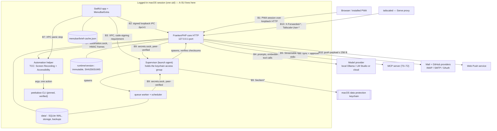

# Baseline threat model (S0-23)

**Status:** Baseline, frozen for Sprint 0 exit · **Version** 1.0.0 · **Date** 2026-10-10
**Owner:** Workstream H (Security/privacy lead) · **Reviewers:** A (macOS/Swift), B (Laravel platform), G (MCP/Automation), C (TALL/PWA)
**Implements:** Blueprint §13.1 ("baseline threat model" as a Sprint 0 artifact), §11 (the blocking security gates), §3.1 (documented residual risk for the unencrypted SQLite file), §6 (the Mac helper privilege boundary reasoned about, not assumed), §13 workstream H DoD ("All security gates green; signed risk acceptance")
**Binding inputs:** [ADR-001](../adrs/001-macos-runtime-packaging.md) · [ADR-002](../adrs/002-local-db-and-queue.md) · [ADR-003](../adrs/003-keychain-and-secrets.md) · [ADR-004](../adrs/004-provider-neutral-ai.md) · [ADR-005](../adrs/005-peekaboo-mcp-security.md) · [ADR-006](../adrs/006-private-remote-access.md) · [ADR-007](../adrs/007-license-and-compliance.md) · [ipc-contract.md](../architecture/ipc-contract.md) · [health-contract.md](../architecture/health-contract.md) · [support-matrix.md](../architecture/support-matrix.md) · [SECURITY.md](../../SECURITY.md)

## 0. How to read this document

This is the baseline: the boundary set, the threat register and the risk acceptances as they stand at
the Sprint 0 architecture freeze. It records what the ADRs and contracts have actually decided, and it
marks every place where the answer is *not yet decided* rather than inventing one. No mitigation in
§3 is advice; each one cites an ADR decision number, a contract section, or is labelled **GAP** and
routed to §6.

| Issue #23 acceptance criterion | Where it is satisfied |
|---|---|
| Enumerates trust boundaries: PWA ↔ core, Swift ↔ core IPC, core ↔ model provider, core ↔ MCP server, core ↔ mail provider, core ↔ Peekaboo helper, local disk, Keychain | §2.2 – §2.11, summarised in §2.12 |
| Each §11 gate maps to at least one concrete threat with a named mitigation and the test that proves it | §3.0 gate map, then the register in §3.1 – §3.14 |
| Covers the SSRF surface explicitly | §3.4, with the per-control checklist in §3.4.1 |
| Covers data at rest: what FileVault does and does not protect while logged in | §4 |
| Lists accepted residual risks, each with a named accepting role | §5 |

Two rules that apply to every row below, so they are not repeated:

1. **Policy decisions live in code, never in prompt text** (§7, §11; ADR-005 D4.8). A mitigation that
   consists of telling a model not to do something is not a mitigation and is not recorded as one.
2. **Fail closed.** Where a control cannot reach a verdict — unknown model capability (ADR-004 D3),
   unknown MCP tier (ADR-005 D4.4 T3), missing region evidence (ADR-004 D5), unreadable secret
   (ADR-003 D3.2 locked state) — the operation is refused, not degraded.

## 1. Scope and assumptions

### 1.1 What this models

The v1 product as the seven ADRs define it: one signed, notarised SwiftUI app on one Mac, a Supervisor
launch agent, three FrankenPHP children (core HTTP, queue worker, scheduler) from an immutable runtime
(ADR-001 D3, D4), one SQLite file in WAL mode (ADR-002 D1), secrets in the macOS data protection
keychain reached through the Supervisor's broker (ADR-003 D1, D3), an optional Peekaboo automation
helper (ADR-005 D3), optional MCP clients (ADR-005 D4), optional email/GitHub integrations, and an
optional Tailscale Serve origin (ADR-006 D1).

### 1.2 Assumptions (v1)

| # | Assumption | Consequence if false |
|---|---|---|
| S1 | **Single owner, single Mac.** One owner account; the IPC resolves to that owner (ipc-contract §2 "v1 is single-owner"). | Multi-user tenancy introduces an authorization boundary this baseline does not model; the register's authz rows (§3.13) become insufficient. |
| S2 | **The realistic adversary class is a process running as the same user.** TCP loopback gives no peer credentials, so "any process running as the same user" can connect to the core (ipc-contract §1.2 trust table). Every control at this boundary is reconstructed at the application layer. | If the Mac is shared or another local account is hostile, the uid-based peer checks (ADR-003 D3.2.1, ADR-005 D3.3) still hold, but the §4 disk conclusions change. |
| S3 | **The user, logged in, is trusted; the content they receive is not.** Mail bodies, web pages, MCP tool descriptions, MCP results and on-screen text are data (§11; ADR-005 D4.8). | — |
| S4 | **macOS platform controls work as Apple documents them**: TCC gates Screen Recording and Accessibility, `securityd` enforces keychain access groups from code-signing entitlements (ADR-003 E5, E17), Gatekeeper requires a correctly signed and notarised bundle from macOS 15 (ADR-001 D5, V4), Hardened Runtime is on every binary we ship (ADR-001 D2; ADR-003 D5 table). | A platform bypass invalidates the Peekaboo boundary (§2.8) and the Keychain boundary (§2.10) simultaneously. |
| S5 | **The app is not App-Sandboxed in v1**, proven rather than assumed (ADR-003 D5 with Apple evidence E11–E16). | — |
| S6 | **Local Only is the default; nothing remote is enabled without a named opt-in** (ADR-006 D1.1–D1.3; ADR-004 D4). | — |
| S7 | **No `.env` file and no secret on disk** (ADR-001 D4; ADR-003 D1). | The redaction surface in ADR-003 D7 would have to grow a filesystem row. |

### 1.3 Attacker classes

Referenced by code in the register's "attacker capability" column.

| Code | Attacker | Capability assumed |
|---|---|---|
| `A-CONTENT` | Author of content the product ingests | Writes arbitrary text into a mail body, a web page the agent fetches, an MCP tool description or result, or a window the agent screenshots. No code execution on the Mac. |
| `A-SU` | Same-user process | Runs arbitrary code as the logged-in user: can read files the user can read, connect to loopback ports and Unix sockets, bind a free port, read `ps`. Cannot inject into a Hardened-Runtime process, cannot join a keychain access group it is not signed for. |
| `A-SU-CORE` | Same-user attacker who achieves code execution **inside** the live core | Everything `A-SU` has, plus whatever the core itself may do: fetch any secret the core may fetch. This is ADR-003 R1 and the strongest class the design accepts. |
| `A-WEB` | Web page in the user's browser | Runs JavaScript in a browser on the Mac; can issue cross-origin requests, probe loopback ports, attempt DNS rebinding, frame our origin. |
| `A-PROV` | Hostile or compromised provider / MCP server | Serves arbitrary responses, redirects, tool schemas and OAuth metadata over a connection the user approved. |
| `A-SUPPLY` | Supply-chain attacker | Compromises an upstream release artefact, a package version, or a transitive dependency before our review. |
| `A-TAIL` | Compromised tailnet device | A still-signed-in device on the user's tailnet; reaches the Serve origin only (ADR-006 D4.2 grants `tcp:443` to the tagged Mac). |
| `A-OFFLINE` | Holder of the powered-off Mac or a backup copy | Physical access with the machine off or pre-boot, or a copy of a backup volume. |

### 1.4 Out of scope for v1

- **Multi-user and hosted deployments.** The `server` backend profile exists and is contract-tested
  (ADR-002 D1, D10) but is never produced by the installer; its network exposure is not modelled here.
- **Linux and Windows** (§0), **Intel Macs** (ADR-001 D5).
- **Third-party services the user connects.** Vulnerabilities in Google, Microsoft, HEY, GitHub,
  Tailscale or a model provider go to the vendor (SECURITY.md "Out of scope"); what we model is what
  *we* send them and what we do with what they return.
- **Social engineering of maintainers** (SECURITY.md), and malicious insiders with the owner's
  credentials and Touch ID.
- **Kernel, firmware and Secure Enclave compromise**, and defeat of FileVault's volume encryption.
- **Formal assurance claims.** This document is a threat model, not a conformity assessment. No EU AI
  Act certification is claimed anywhere in this product (§0; ADR-007 D5 forbidden phrasings).

### 1.5 STRIDE shorthand

`S` spoofing · `T` tampering · `R` repudiation · `I` information disclosure · `D` denial of service ·
`E` elevation of privilege.

## 2. Trust boundaries

### 2.1 Map



Plain-text fallback, outermost boundary first:

```text
A-OFFLINE ....... powered-off Mac / backup volume        -> FileVault volume key (§4)
A-CONTENT ....... mail body, web page, tool description  -> data, never instruction (B4,B5,B6)
A-PROV .......... model provider, MCP server, mail, push -> TLS + egress policy (B4,B5,B6)
A-TAIL .......... tailnet device -> tailscaled Serve     -> one origin, tcp:443 only (B10)
A-WEB ........... browser page -> loopback port          -> origin/Sec-Fetch checks (B1,B2)
A-SU ............ same-uid process -> loopback port,     -> signed envelopes, peer verification
                  secrets.sock, automation.sock, disk        (B2,B7,B9), none for the DB file (B8)
A-SU-CORE ....... code inside the live core              -> immutable runtime, audit, locked state
```

### 2.2 B1 — PWA ↔ core

The PWA is served by the same core it talks to, over `http://127.0.0.1:<port>` locally and
`https://my-mac.example-tailnet.ts.net` when Remote Access is on (ADR-006 D3). Two origins, one
process, host-only cookies, so the two sessions never mix (ADR-006 D3 `SESSION_DOMAIN = null`).

| What crosses | Direction | Authentication | Integrity |
|---|---|---|---|
| Owner login, session cookie | browser → core | owner credential, passkey/MFA from Sprint 2 (§11; S1-02, E2-3) | `SESSION_HTTP_ONLY=true`; `session.secure` computed per request by `ResolveRequestOrigin` (ADR-006 D3) |
| Livewire actions (CRM writes, approvals, MCP grants, model config) | browser → core | session + Laravel policy per action (§11; ipc-contract §11.1 states the same rule for the IPC side) | CSRF two-layer: `Sec-Fetch-Site` origin check with token fallback; `originOnly` and `allowSameSite` forbidden (ADR-006 D3) |
| Approval decisions and re-authentication | browser → core | **only** path that may grant an approval (ipc-contract §11.2; ADR-005 D1.6) | frozen proposal with hash, approver identity, expiry, nonce (§11; E2-4) |
| Brief, CRM and inbox documents | core → browser | session + policy | `Cache-Control` and service-worker rules: app shell only, never `/briefs/*`, `/crm/*`, `/inbox/*` or a `Set-Cookie` response (§1.2; ADR-006 D3, "Forbidden in code review") |
| Web Push subscription (`endpoint`, `p256dh`, `auth`) | browser → core | session; opt-in per device behind a user gesture | stored in `push_subscriptions`, encrypted at rest; VAPID private key only in the Keychain (ADR-006 D5.3) |

### 2.3 B2 — Swift menu bar ↔ core (IPC)

Owned by [ipc-contract.md](../architecture/ipc-contract.md) at version 1.0.0. The transport gives
nothing (TCP loopback has no peer credentials, §1.2), so three application-layer controls are
**mandatory, not defence in depth**: a session-bound token derived from a Keychain HMAC key (§3),
request signing (§4.2), and response signing so a hijacked port is detected (§4.5).

| What crosses | Direction | Authentication | Integrity |
|---|---|---|---|
| `GET /ipc/v1/health`, `/health/ready` | GUI or Supervisor → core | `Bearer lxai1.…` token, scope in the MAC (§2, §3.3) | HMAC request + response signature (§4.2, §4.5) |
| `GET /ipc/v1/briefs/latest`, `/approvals?state=pending` | GUI → core | token + `viewBrief` / `viewApprovals` gate as the owner, `via: ipc` (§2, §11.1) | ETag `"<id>:<version>"` over an immutable frozen version (§6.2) |
| `POST /ipc/v1/ai/pause`, `/resume`, `/heartbeat` | GUI → core | token + gate; heartbeat is the only authenticated signal `menubar_integration` reads (§6.5) | nonce + ±30 s timestamp window (§4.1, §4.3) |
| `POST /ipc/v1/oauth/callback` — `code` and `state` only | GUI → core | token + `completeOAuth`; `state` looked up in a 10-minute cache (§6.6; ADR-003 D4) | body excluded from every dump; `code` never logged (§6.6; ADR-003 D7 row 1) |
| `POST /ipc/v1/remote-access/enable` | GUI → core | token + gate + **elevation** `X-Lxai-Elevation` minted by the Supervisor after device-owner authentication (§7.3) | `confirmed_origin` compared, never passed to a CLI argument (§6.7) |

What this boundary deliberately does **not** carry: approvals (§11.2), service control (§6.8, which
goes over XPC), and panic stop (§0, which must work with the core down).

### 2.4 B3 — GUI ↔ Supervisor (XPC)

Mach service `<bundle-prefix>.supervisor.control` (prefix pending A12), `NSXPCListener` with
`setCodeSigningRequirement` to our Team ID on both ends (ipc-contract §7). This is the only place in
the design where a peer identity is cryptographically available at the transport layer, which is why
pairing, elevation and service control live here rather than on B2 (§6.8 reasons 1–3).

| What crosses | Direction | Authentication | Integrity |
|---|---|---|---|
| `pair(client:)` → pairing grant (token + signing key + port) | GUI → Supervisor | code-signing requirement; one live session per client | grant written to the GUI's own private Keychain item, `AccessibleAfterFirstUnlock`, not synchronizable (§3.1; ADR-003 D5) |
| `resetPairing()` | GUI → Supervisor | code-signing requirement + confirmation sheet | regenerates `K`; every derived token and signing key dies at once (§3.4); `audit_events{type: ipc.pairing_reset}` |
| `services()`, `restart()`, `stopAll()`, `startAll()` | GUI → Supervisor | code-signing requirement + confirmation sheet | Supervisor's own bookkeeping and ADR-001 D3 restart budget (5 per 10 min) |
| `elevate(sessionId:operation:nonce:)` | GUI → Supervisor | `LAContext.evaluatePolicy(.deviceOwnerAuthentication)` — Touch ID or login password | one-shot elevation bound to session, operation, nonce, 60 s (§7.3) |

### 2.5 B4 — core ↔ model provider

| What crosses | Direction | Authentication | Integrity |
|---|---|---|---|
| Prompts, mail/CRM context, tool definitions, tool results, screenshots (while an automation session is active) | core → provider | local: none required on loopback; cloud: API key fetched from the Keychain at call time, never from `.env` (ADR-004 D2 `Ai::build`) | TLS for cloud; host allowlist and pinned resolved IP under `LOCAL_ONLY` (ADR-004 D4.2) |
| Completions, tool-call proposals, structured output | provider → core | — | a tool call is a **proposal**: `SdkToolBridge::handle()` consults `PolicyGate` before the wrapped tool runs (ADR-004 D2 tools row; §4 "LLM ska generera förslag, aldrig egna behörigheter") |
| Embeddings | core → provider | same as above | same adapter, same middleware (ADR-004 D4.5) |

Under `LOCAL_ONLY` three independent layers each block egress on their own: the registry never builds
a non-local adapter (D4.1), the host allowlist is loopback-only with DNS resolved and pinned before
the request (D4.2), and `Http::globalRequestMiddleware()` throws `EgressBlockedException` before a
socket opens, re-checking redirects (D4.3). `EgressBlockedException` is deliberately not a
`FailoverableException` (D4.4), and we never pass an array of providers, so the SDK's silent
`withModelFailover()` path is unreachable (D2).

### 2.6 B5 — core ↔ MCP server

Only `app/MCP/McpConnectionFactory` may construct a client; a direct `Client::web`/`Client::local`
call elsewhere is a review failure (ADR-005 D4.2). Tier is stored in `mcp_servers.trust_tier` and
decided in code (D4.4); tool annotations are recorded and **never** used for policy, because the spec
says annotations from untrusted servers must not be trusted and only T0 is trusted.

| What crosses | Direction | Authentication | Integrity |
|---|---|---|---|
| `initialize`, `tools/list` | core → server | T2: OAuth 2.1 with mandatory `S256` PKCE, RFC 8707 `resource`, RFC 9207 `iss` validation, or a bearer token from the Keychain (`se.stafe.executive-ai.mcp`) | `https` only (loopback `http` only for our own server), host allowlist, DNS resolved once and pinned, `allow_redirects => false` with any 3xx an error (D4.2 a–c) |
| Tool call arguments (may contain CRM data) | core → server | per-tool grant in `mcp_grants`; T2 requires action approval on every call that sends CRM data (D4.4) | argument hash, server, tool, outcome, duration in `audit_events` — never raw CRM content (D4.6) |
| Tool names, titles, descriptions, result text, resource contents | server → core | — | stored and rendered as data; passed to the model inside a delimited "untrusted tool output" block with the server name; results > 64 KiB truncated; `resource_link` and embedded `file://` URIs never auto-fetched (D4.8) |
| `tools/list` on reconnect | server → core | — | compared against `mcp_tools.schema_hash = sha256(canonical tools JSON)`; any difference suspends **all** grants for that server until the user re-reviews (D4.6 rug-pull protection) |
| Local stdio spawn | core/helper → server process | entry in `config/mcp-local-allowlist.json` only, SHA-256 verified before each spawn | `symfony/process` array form, minimal environment, no inherited `PATH`, per-server `HOME`, no Keychain access, no inherited tokens (D4.5). v1 ships the list empty of third-party servers; everything else is T3 and blocked by the compile-time constant `McpFeatures::THIRD_PARTY_LOCAL = false` |

### 2.7 B6 — core ↔ mail provider (IMAP / SMTP / OAuth)

| What crosses | Direction | Authentication | Integrity |
|---|---|---|---|
| OAuth authorization request | GUI/browser → provider | `ASWebAuthenticationSession` or the system browser, PKCE, `state`, redirect allowlist, explicit scope consent; no embedded webview ever collects a password (§5.6; ADR-003 D4) | `state` + `code_verifier` in a 10-minute file cache, verifier hashed into the cache key, never logged (ADR-003 D4) |
| `code` + `state` back to the core | GUI → core | B2 with `completeOAuth` (ipc-contract §6.6) | token exchange performed by PHP; result written via `SecretStore::put`; the GUI never holds a token (ADR-003 D4) |
| Mailbox reads (Gmail API, Graph delta, IMAP UID/UIDVALIDITY) | core → provider | per-connection credential from the Keychain, one item per `email_connections.id` (ADR-003 D1) | strict certificate verification (§5.2); idempotent upserts on `(connection_id, provider_message_id)` (ADR-002 D3.3) |
| Mail bodies, HTML, attachments | provider → core | — | HTML sanitised; attachments never auto-opened or executed (§5.6); content is `A-CONTENT` input per §1.2 S3 |
| `send` / `reply` / `forward` / `delete` / `move` | core → provider | read-only is the ground state; a separately granted provider scope **plus** an immutable approval per message; sender identity bound to the chosen account (§5.6) | frozen proposal, recipient and body hash, approver identity, expiry, nonce, idempotency, fail closed (§11; E2-4) |

Cross-account isolation is a Laravel policy on every read, job, AI tool and send (§5.6 criterion 4),
with the negative tests running on both backend profiles (ADR-002 D10 `cross-account` group).

### 2.8 B7 — core ↔ Peekaboo helper, and the helper's privilege boundary

This is the sharpest privilege asymmetry in the product, and §6 requires it to be reasoned about.
**Only the helper holds Screen Recording and Accessibility; the core and the menu-bar app never get
them** (ADR-005 D3.1). TCC attributes the grant to the helper as the responsible process for the
Peekaboo child (D1.4). So the helper can observe and drive the GUI of allowlisted apps — something
the core, by construction, cannot do even if fully compromised. In exchange the helper holds **no
credential** and has no Keychain entitlement (ADR-003 D2, D5 table).

| What crosses | Direction | Authentication | Integrity |
|---|---|---|---|
| `observe()` / `execute()` frames | core → helper over `run/automation.sock` (dir `0700`, socket `0600`) | `LOCAL_PEERCRED` uid equality, `LOCAL_PEERPID` plus `SecCodeCopyGuestWithAttributes` + `SecCodeCheckValidity` against our Team ID requirement; session-bound 256-bit token in the Keychain, rotated on every helper start and on panic stop (D3.3, D3.4) | `sig = HMAC-SHA256(token, canonical_json(v,id,ts,nonce,method,params))`; unknown major, skew > 30 s, replayed nonce (LRU 10 000) and bad signature rejected into `audit_events{type: automation.ipc_rejected}`; responses signed the same way so the core detects a hijacked socket (D3.5) |
| Panic stop | GUI → helper over XPC | `setCodeSigningRequirement` to our team | works with the core down; kills the child, releases held modifiers and mouse buttons, marks the session `aborted`, revokes the grant, must complete < 1 s (D1.9) |
| One action at a time | helper → `peekaboo` child by argv, `--no-remote`, JSON output | pinned tag `v4.9.0`, SHA-256 from `packaging/peekaboo/manifest.json`, `codesign --verify --strict --check-notarization -R='notarized'`, expected Authority/TeamIdentifier/Identifier, **re-verified before every launch** (D1.1, D1.2) | forbidden: `peekaboo agent`, `peekaboo mcp`, `peekaboo daemon`, any bridge socket, the `shell` tool, clipboard writes, `set_value`/`select_text` outside allowlisted elements (D1.3) |
| Screenshots | helper → core → model | session grant, max 15 min idle / 60 min total / 25 actions (D1.6, D1.8) | `AXSecureTextField` regions, Wi-Fi/password menus and secret-labelled elements blacked out, non-allowlisted overlapping windows masked, before anything leaves the helper; never written to disk, DB, logs or the audit trail — only a SHA-256 for correlation (D1.7) |

Double-checked allowlist: every `observe()`/`execute()` validates the target bundle id in the helper
(Swift) **and** in PHP `AutomationPolicy` — two independent checks, both fail closed (D1.5). The hard
denylist stands regardless of user choice: `loginwindow`, `SecurityAgent`, System Settings, Keychain
Access, password managers, authenticator apps, Terminal/iTerm, and any window whose focused element
is an `AXSecureTextField`. Session gating on an unlocked on-console session is explicit (D2), and the
product will not keep the display awake outside a session, suppress the screen saver, or send input
to a locked screen (D2, D5).

### 2.9 B8 — local disk

| What crosses | Direction | Authentication | Integrity |
|---|---|---|---|
| `data/database/executive.sqlite` + `-wal` + `-shm` | core, worker, scheduler ↔ disk | **filesystem only** — any same-uid process can read it (§1.2 S2; ADR-003 R2) | WAL, `busy_timeout 5000`, `BEGIN IMMEDIATE`, `secure_delete=ON`, 0700 directory (ADR-002 D2; ADR-003 D6) |
| `runtime/<version>/` — binary, Caddyfile, php.ini, Laravel source, `bootstrap/cache` | Supervisor verifies, core executes | — | `SHA256SUMS` plus code signature verified by the Supervisor **on every boot**, fail closed; `chmod -R a-w` after install; nothing under `runtime/` is written at run time (ADR-001 D3, D4) |
| `backups/app-<ts>.sqlite` | backup job → disk | — | `VACUUM INTO` on a read-only connection, `PRAGMA integrity_check` on the copy, atomic rename, then encryption with the Keychain key `se.stafe.executive-ai.backup` (ADR-002 D5; ADR-003 D1). File-level copies of the live DB are forbidden in review (ADR-002 D5) |
| `~/Library/Logs/LaravelExecutiveAI/`, `failed_jobs`, `audit_events` | core/worker/Supervisor → disk | — | `RedactSecretsProcessor` tapped on **every** channel; `APP_DEBUG=false` in packaged config; `failed_jobs.exception` passes through the `Redactor` (ADR-003 D7 rows 1–3) |
| `menubar/brief-cache.json` | GUI → disk | — | mode `0600`, excluded from Time Machine with `isExcludedFromBackupKey`, deleted on "Reset security pairing" and uninstall (ipc-contract §6.2) |
| Diagnostics export | user action → chosen path | explicit user click | allowlisted sources only; never `data/`, never the Keychain, never `bootstrap/cache`; `Redactor` over every byte; archive list previewed (ADR-003 D7 row 9; ADR-007 D9) |

### 2.10 B9 — Keychain and the secrets broker

Exactly one process holds the shared access group `<TEAMID>.se.stafe.executive-ai.secrets`: the
Supervisor (ADR-003 D2). FrankenPHP carries `com.apple.security.cs.allow-jit` and **no** keychain
entitlement; the helper has none; the GUI has only its own private pairing item (ADR-003 D5 table).
A process outside the group that queries an item gets `errSecItemNotFound`, and one that tries to
write gets `errSecMissingEntitlement` — decided by `securityd` from code-signing entitlements, with
no user prompt and no ACL dialog to social-engineer (ADR-003 D2 with E5, E7, E17).

| What crosses | Direction | Authentication | Integrity |
|---|---|---|---|
| `get` / `put` / `delete` / `list` / `health` frames | PHP child → Supervisor over `run/secrets.sock` (dir `0700`, socket `0600`) | four conditions, all required: peer uid equals the Supervisor's; peer pid is a child or ppid-chain descendant of a process it spawned; the peer's audit token resolves through `SecCodeCopyGuestWithAttributes` to code satisfying the FrankenPHP designated requirement for our Team ID (the audit token carries the pid version, defeating pid reuse); and the broker is not **locked** (ADR-003 D3.2) | length-prefixed versioned JSON frames; no shared bearer token — the peer identity *is* the credential; the broker never caches, every `get` is a Keychain read (D3.1) |
| `SecretValue` in PHP | Supervisor → PHP process memory | — | final class; `__serialize()`, `jsonSerialize()`, `__debugInfo()` and `__toString()` throw or mask; `sodium_memzero()` on destruct; cached at most for the current request/job (D3.4) |
| Keychain items | Supervisor ↔ `securityd` | access group from entitlements | `kSecUseDataProtectionKeychain = true`, `kSecAttrSynchronizable = false` always, `kSecAttrAccessibleAfterFirstUnlock`, no `kSecAttrAccessControl` on service credentials so the 05:00 brief can run unattended, `kSecAttrAccount` never an email address or other PII (D1) |
| `secrets.changed` notification | Supervisor → core | — | the core re-reads `K` on the next request, 5 s upper bound (ipc-contract §3.4) |

The broker's **locked** state is the compromise response: the menu bar's panic/stop action refuses
every `get` instantly, and the audit log of `get` operations (service, account, pid, timestamp, never
the value) is the first artefact an incident review reads (ADR-003 D8).

### 2.11 B10 — optional Tailscale Serve origin

Off by default (ADR-006 D1.1). When on, `tailscaled` terminates TLS and proxies to
`http://127.0.0.1:<port>`; the listener bind address is a constant, not configuration (D6.5).

| What crosses | Direction | Authentication | Integrity |
|---|---|---|---|
| HTTPS requests from tailnet devices | `A-TAIL` → tailscaled → core | the app's own session/passkey; `Tailscale-User-*` headers are read **for audit only** and never for authentication (D3) | `TrustProxies at: ['127.0.0.1','::1']` (never `'*'`), exactly the three `X-Forwarded-*` headers Serve sets; `TrustHosts` admits the DNS name only while `remote.origin` is set, `subdomains: false` (D3) |
| Enable / disable | GUI → core → CLI | elevated IPC operation (ipc-contract §6.7) | `TailscaleCommand` allowlists subcommands `{version, status, serve}` and flags `{--json, --bg, --yes, --https=443, off}`; absolute bundle path, never `PATH`; no argv may contain `funnel`, `0.0.0.0`, `--http=` or `--tcp=` (D2, D6.1–D6.2) |
| Self-verification after enable | core → own origin | — | `GET https://<dnsname>/healthz` must return `200` with `X-Lxai-Origin: <dnsname>` (D2 verify step 2) |
| Push payload | core → push service | VAPID (RFC 8030/8291/8292) | one fixed JSON shape, ≤ 256 bytes, generic title, `TTL ≤ 3600` s (approvals ≤ 900 s); no customer text, no token, no URL with a secret (D5.4) |

`/ipc/*` and `/health/*` are unreachable through Serve independently of any route allowlist, because
the presence of any `X-Forwarded-*` or `Tailscale-User-*` header is itself a rejection on those
routes (ipc-contract §5.2.3; health-contract §6). The MCP route is not part of the Serve surface in
v1 (ADR-005 D4.10).

### 2.12 Boundary summary

| ID | Boundary | Peer identity available? | Primary control | Register rows |
|---|---|---|---|---|
| B1 | PWA ↔ core | no (browser) | session + policy per action, CSRF two-layer, origin headers | T-17 – T-22, T-70 – T-73 |
| B2 | Swift menu bar ↔ core | no (TCP loopback) | token from Keychain `K`, request and response signing, nonce + skew window | T-30 – T-35 |
| B3 | GUI ↔ Supervisor | **yes** (XPC code-signing requirement) | pairing, elevation, service control live here | T-34, T-71 |
| B4 | core ↔ model provider | n/a | three-layer `LOCAL_ONLY` egress veto, PolicyGate before any tool runs | T-08, T-23 – T-29, T-66 – T-69 |
| B5 | core ↔ MCP server | server-side only (OAuth/TLS) | tiers in code, per-tool grants, schema-hash drift suspension, no redirects | T-02, T-09, T-52 – T-56 |
| B6 | core ↔ mail provider | provider OAuth / app password | read-only default, approval per send, per-connection Keychain item | T-01, T-05, T-73 |
| B7 | core ↔ Peekaboo helper | **yes** (peer code signature + HMAC token) | helper is the only TCC holder and holds no credential; allowlist checked twice | T-04, T-16, T-57 – T-61 |
| B8 | local disk | no | immutable runtime with SHA256SUMS; the DB file has **no** process-level protection | T-42 – T-46 |
| B9 | Keychain + broker | **yes** (audit token + process tree) | one access group in one process; locked state; per-`get` audit | T-36 – T-41 |
| B10 | Tailscale Serve origin | tailnet identity (audit only) | one origin, `tcp:443` grant, Funnel unreachable by construction | T-62 – T-65 |

## 3. Threat register

### 3.0 Legend and §11 gate map

**Status values.** `mitigated` — the control is specified in a frozen contract or an ADR decision and
a named test will prove it in the sprint given; `planned-S1`/`planned-S2`/`planned-S3`/`planned-S4` —
the control is specified but the implementation and its test land in that sprint; `accepted` — the
residual risk is carried, with a row in §5; `GAP` — no ADR or contract decides this yet, routed to §6.

A `planned-*` status is **not** a claim that the product is protected today. Sprint 0 ships contracts
and fixtures, not enforcement; the only security code that exists at this freeze is the fixture
validator and the expected-failing test of S0-21.

**Every §11 gate maps to at least one threat:**

| §11 gate | Threats |
|---|---|
| Auth: passkeys/WebAuthn or MFA, secure sessions, session revocation, device management, re-auth for critical actions | T-70, T-71, T-72 |
| Laravel authorization: policies/gates in every HTTP action, Livewire action, queued job, MCP tool, AI tool and integration call; IDOR / multi-tenant cross-access tests | T-35, T-55, T-73 |
| Secrets: Keychain per service identity; never tokens in app logs, crash dumps, prompts, push, screenshots, mail brief or repo | T-10 – T-15, T-36 – T-41 |
| Prompt injection: all externally collected text is data, not instruction; threat-model indirect injection, exfiltration and browser-based attacks | T-01 – T-07 (injection), T-08 – T-16 (exfiltration), T-17 – T-22 (browser-based) |
| SSRF: DNS/IP checks in `Browser/Fetch`, block loopback, RFC 1918, metadata and Unix-socket targets, revalidate redirects, ports, protocols | T-23 – T-29, checklist in §3.4.1 |
| MCP: capability allowlist, trust tier, isolate untrusted processes, revoke immediately, no arbitrary shell | T-02, T-52 – T-56 |
| Outbound actions: frozen immutable proposal, input/recipient/hash, approver identity, expiry, nonce, idempotency, fail closed | T-01, T-05, T-09, T-35, T-73 |
| Supply chain: signed/notarised Mac artifacts, pinned Composer/npm/Swift deps, SBOM, SCA, code-signing verification, reproducible build where feasible | T-47 – T-51 |
| Security testing: OWASP ASVS-aligned web checks, SAST, dependency scanning, DAST for HTTP endpoints, native entitlement review, third-party penetration test before v1.0 | T-74, T-75 |

### 3.1 Indirect prompt injection

The gate (§11) names this explicitly. The design answer is structural: text from outside is never an
instruction, policy is evaluated in code, and no grant, approval or permission can originate in a
model output (ADR-005 D1.6, D4.8; ADR-004 D2).

| ID | Boundary | Threat (STRIDE) | Attacker capability | Impact | Mitigation (citation) | Test that proves it | Status |
|---|---|---|---|---|---|---|---|
| T-01 | B6 → B4 | Instructions in a mail body make the agent send customer data to an attacker address (S, E) | `A-CONTENT` sends mail to a synced account | customer data exfiltrated under the owner's own sending identity | Mail content is data (§11; ADR-005 D4.8 delimited untrusted block); every `send` needs a separately granted provider scope **and** a frozen immutable approval with recipient and body hash (§5.6; §11); `PolicyGate` runs before the wrapped tool, not after (ADR-004 D2 tools row) | `tests/Security/ForeignEmailCannotTriggerSendTest.php` (**S0-21**, committed as an expected-failing gate, turns green with E2-4); corpus `packaging/fixtures/security/prompt-injection/` (**S0-19**) | planned-S2 |
| T-02 | B5 | Tool poisoning: model instructions inside an MCP tool name, title or description, or a changed schema after approval (T, E) | `A-PROV` controls an approved server | the model is steered into calling a tool with data the user never approved | Descriptions and results are stored and rendered as data, never inserted into the system prompt and never allowed to change the tool list the model sees (ADR-005 D4.8); annotations recorded but never used for policy (D4.4); `mcp_tools.schema_hash` drift suspends **all** grants for that server until re-review (D4.6) | hostile-MCP fixtures `packaging/fixtures/security/hostile-mcp/` including the schema-mutating server (**S0-19**); planned `McpSchemaDriftTest` in `tests/Integration/Mcp/` (**E3-5**) | planned-S3 |
| T-03 | B4 | Instructions in fetched web content (`Browser/Fetch`, `Browser/Search`) are followed as commands (S, E) | `A-CONTENT` controls a page the agent fetches | tool calls or outbound actions the user did not ask for | Fetched text enters the same delimited untrusted-output path as MCP results (ADR-005 D4.8 — the same renderer); `resource_link` and embedded `file://` URIs are never auto-fetched (D4.8); agent bounds cap the blast radius: `max_steps` 8/12 with a hard ceiling of 25, `max_cost_per_run` €0.50, dedupe window (ADR-004 D7) | prompt-injection corpus row "instructions in fetched web content" (**S0-19**); planned `FetchedContentIsDataTest` (**E2-5**) | planned-S2 |
| T-04 | B7 | Injection via on-screen text inside the allowlisted Safari window — a crafted page tells the agent to click something harmful (S, E) | `A-CONTENT` controls a page the user has open | an authorised click goes somewhere the user did not intend; the agent cannot judge intent | Per-action authorization with a frozen `action_proposals` row (app, window title, element role and label, redacted value, screenshot hash, expiry, nonce) and a matching `action_approvals` row (ADR-005 D1.6); session grant is time- and action-bounded (D1.8); allowlist checked in Swift and in PHP `AutomationPolicy` (D1.5) | planned `AutomationPerActionApprovalTest` and `AutomationAllowlistTest` (**E3-6**); first-run screen text reviewed by H | **accepted** (RR-06) |
| T-05 | B6 | Injected instruction changes the `From` identity so a message appears to come from another of the user's accounts (S) | `A-CONTENT` | impersonation across the user's own identities; the audit trail misattributes the act | Sender is bound to the chosen account; "en agent får aldrig byta From-identitet" (§5.6); the approval freezes sender, recipient and body before the approver sees it (§11) | `ForeignEmailCannotTriggerSendTest` covers the From-identity variant explicitly (**S0-21** criterion 3) | planned-S2 |
| T-06 | B5, B7 | Injection grants itself permission: a model output purports to approve an action, issue an automation session grant or add an MCP tool grant (E) | `A-CONTENT` or `A-PROV` | the approval gate becomes decorative | "Session grants and approvals are never issued from a prompt or a tool result; only from an authenticated, re-authenticated UI action" (ADR-005 D1.6); approvals are never granted through IPC, with or without elevation (ipc-contract §11.2); tiers and grants are code, not prompt (ADR-005 D4.4) | `IpcPolicyArchTest` — no `/ipc/*` route resolves to an approval-mutating service (**S1-08**); planned `GrantOriginTest` (**E2-4**) | planned-S1 |
| T-07 | B4 | Injection targets memory: the model writes a false "standing instruction" into permanent memory and influences every later run (T) | `A-CONTENT` | persistent compromise of agent behaviour from one email | Conversation, memory and user profile are app-owned; "LLM kan inte uppdatera permanent minne utan annoterad, granskad operation" (§4); `ai_runs` carries provenance and a prompt hash so a bad run is attributable (ADR-004 D7) | planned `MemoryWriteRequiresReviewTest` (**E2-5**) | planned-S2 |

### 3.2 Exfiltration

| ID | Boundary | Threat (STRIDE) | Attacker capability | Impact | Mitigation (citation) | Test that proves it | Status |
|---|---|---|---|---|---|---|---|
| T-08 | B4 | Exfiltration inside a model request: prompts, mail bodies, CRM notes, embeddings or screenshots reach a cloud provider while the user believes Local Only holds (I) | `A-CONTENT` steering, or a configuration mistake | the product's central privacy promise breaks silently | Three independent layers, each sufficient alone: the registry builds only `{ollama, openai-compatible}` adapters on allowlisted hosts (ADR-004 D4.1); a loopback-only host allowlist with DNS resolved and the IP pinned before the request (D4.2); `Http::globalRequestMiddleware()` throws `EgressBlockedException` before a socket opens and re-checks redirects (D4.3). Embeddings, screenshots, transcripts and prompts all pass the same adapter (D4.5) | `tests/Security/LocalOnlyEgressTest.php` on every CI run, plus the release-blocking Mac-lab `tcpdump` run with an empty capture attached to the release checklist (ADR-004 D4 evidence; §14 "locality test with packet capture") | planned-S2 |
| T-09 | B5 | Exfiltration via tool-call arguments to a remote MCP server after a legitimate approval (I) | `A-PROV` plus `A-CONTENT` steering | CRM data leaves in a call the user approved once for a different purpose | T2 treats every tool as mutating and open-world until reviewed, and requires an action approval on every call that sends CRM data (ADR-005 D4.4); grants are per tool in `mcp_grants`; the audit records server, tool and **argument hash**, never raw content (D4.6); `LOCAL_ONLY` disables T2 entirely and blocks registry discovery (D4.9) | planned `McpT2ApprovalRequiredTest` and `McpAuditNoRawContentTest` (**E3-5**) | planned-S3 |
| T-10 | B8 | Secrets or customer data in Laravel log channels (I) | `A-SU` reads `~/Library/Logs` | credential theft without any exploit | `RedactSecretsProcessor` tapped on **every** channel in `config/logging.php`; `Log::shareContext` carries ids only; `Context::addHidden` for job-borne values; the `Redactor` is key-based, pattern-based **and** registers every live `SecretValue` the process fetched (ADR-003 D7 row 1) | `LogRedactionTest` and `LoggingConfigTest` against `tests/Security/fixtures/secrets-corpus.json` (**S1-01**; corpus owned by H) | planned-S1 |
| T-11 | B8 | Secrets in exception messages, stack traces, `failed_jobs` or a debug page (I) | `A-SU`, or any viewer of an error screen | a token in a rendered error or a persisted failure row | `APP_DEBUG=false` in packaged config; HTTP client exceptions wrapped so `RequestException` never carries headers or a URL with `access_token=`; `dontFlash` for `password`, `code`, `client_secret`; `failed_jobs.exception` through the `Redactor` (ADR-003 D7 rows 2, 3) | `ExceptionRedactionTest`, `PackagedConfigTest`, `QueuePayloadTest` (**S1-01**) | planned-S1 |
| T-12 | B8 | Secrets in queue payloads (I) | `A-SU` reads the `jobs` table | the queue becomes a secret store | Jobs receive `SecretRef` and model ids, never `SecretValue` — whose `__serialize()` throws; `SerializesModels` stores identifiers only; jobs carrying provider responses implement `ShouldBeEncrypted` (ADR-003 D7 row 3) | Pest arch test "no job property typed `SecretValue`" and `QueuePayloadTest` (**S1-01**) | planned-S1 |
| T-13 | B4, B8 | Secrets or credentials inside AI prompts, tool schemas or stored transcripts (I) | `A-CONTENT` asking, or sloppy tool design | a token handed to a third-party model | Tools take `connection_id`, never credentials; schema lint rejects a parameter named like a secret; `ai_runs`/`tool_runs` persistence passes prompts and transcripts through the `Redactor`; an arch test forbids `App\AI` depending on `SecretValue` (ADR-003 D7 row 4); "tools that accept a provider token from the model" is a review failure (ADR-003 Forbidden 6) | `ToolTranscriptRedactionTest`, `ToolSchemaTest` (**E2-5**) | planned-S2 |
| T-14 | B8 | Secrets or customer text in a diagnostics export the user is about to send to a maintainer (I) | the user, helpfully | a support bundle becomes a credential leak | Allowlisted sources only (health events, redacted logs, versions, entitlements dump); never `data/`, never the Keychain, never `bootstrap/cache`; `Redactor` over every byte; requires a user click and an archive-list preview (ADR-003 D7 row 9; ADR-007 D9) | `DiagnosticsExportTest` with the corpus planted everywhere, zero matches and no `data/` paths in the archive (**S1-01**); `tests/Security/DiagnosticsExportScrubTest` (ADR-007 D9) | planned-S1 |
| T-15 | B10 | Exfiltration via push payload or push metadata (I) | `A-PROV` at the push service, or anyone reading a lock screen | customer names or a token on a lock screen; Apple learns that and when a notification was sent | One fixed JSON shape per type, ≤ 256 bytes, generic human-visible title, `TTL ≤ 3600` s; no customer names, subjects, amounts, snippets, tokens or URLs with secrets; content is fetched over the tailnet origin on tap (ADR-006 D5.4); RFC 8291 end-to-end encryption means even a decrypted payload carries no customer text (D5.5) | `PushPayloadSchemaTest` snapshot plus the negative test that feeds a brief full of customer names and asserts none appear in the serialised payload (ADR-006 D5.6; ADR-003 D7 row 7) — **E4-1** | planned-S4; metadata **accepted** (RR-12) |
| T-16 | B7 | Exfiltration via a retained screenshot or typed text (I) | `A-SU` reading `Caches/`, or anyone reading the audit log | screen content including another app's data persisted outside the session | Redaction happens in the helper before anything leaves it; redacted images go to the model only while a session is active and are **never** written to disk, the database, logs or the audit trail — the audit stores a SHA-256 only; typed text is never logged (ADR-005 D1.7, D1.10) | `AuditNoBlobTest` (no binary columns, no image paths in audit rows) plus the password-field redaction fixture (ADR-003 D7 row 8) — **E3-6** | planned-S3 |

### 3.3 Browser-based attacks against the loopback core

§11 names browser-based attacks as a required modelling target. The core is an HTTP server on
`127.0.0.1`, so every page the user visits is adjacent to it.

| ID | Boundary | Threat (STRIDE) | Attacker capability | Impact | Mitigation (citation) | Test that proves it | Status |
|---|---|---|---|---|---|---|---|
| T-17 | B2 | DNS rebinding: a page resolves its own hostname to `127.0.0.1` and issues requests to `/ipc/v1/*` with the browser's permission (S, E) | `A-WEB` | read of briefs and approvals, or a mutating IPC call, from any web page | Four independent checks, all required: the peer address is `127.0.0.1`; `Host` is exactly `127.0.0.1:<port>` (`localhost` and `[::1]` rejected on `/ipc/*`); no `X-Forwarded-*` or `Tailscale-User-*` header is present; and **no `Origin`, `Referer`, `Cookie` or `Sec-Fetch-*` header is present** — browsers always send at least `Sec-Fetch-Mode`, native clients never do (ipc-contract §5.2). A request also still needs a valid HMAC signature over method, path, timestamp, nonce and body hash (§4.2), which a page cannot forge | `IpcOriginTest` — `Host: localhost`, `X-Forwarded-For`, `Origin`, `Sec-Fetch-Mode` each produce `origin_rejected`; `IpcBindTest` asserts the listener has no non-loopback socket; Swift `IpcOriginClientTest` — the client targets the literal `127.0.0.1:<port>` only, never sends `Origin`/`Referer`/`Cookie`/`Sec-Fetch-*`/`X-Forwarded-*`, refuses every redirect (**S1-08**, both ends) | mitigated |
| T-18 | B1 | DNS rebinding or cross-site requests against the **PWA** routes rather than `/ipc/*` (S, E) | `A-WEB` | CRM writes or approval actions ride the owner's session | `TrustHosts` admits only `^127\.0\.0\.1$`, `^localhost$` and, when enabled, the exact tailnet DNS name, `subdomains: false` (ADR-006 D3); CSRF `PreventRequestForgery` in its two-layer default — `Sec-Fetch-Site` origin check with token fallback — with `originOnly: true` and `allowSameSite: true` forbidden in review (ADR-006 D3 and "Forbidden in code review") | `tests/Feature/Pwa/TrustedHostsTest.php` (**S1-04**): spoofed `Host` refused, loopback names served, `X-Forwarded-Host` from a non-proxy ignored; the CSRF half is Laravel's default `PreventRequestForgery` (**S1-02**); `PwaOriginAndCsrfTest` over both origins lands with the tunnel (**E4-1**, **E2-3**) | partial-S1 |
| T-19 | B1 | Classic CSRF on a state-changing Livewire action (T) | `A-WEB` | an action executed as the owner without the owner's intent | The same two-layer CSRF as T-18; `Content-Type: application/json` is required with a body on `/ipc/*`, so no simple-request CSRF path exists there (ipc-contract §5.2.5); every mutating action additionally runs its policy (§11) | planned `PwaOriginAndCsrfTest` (**S1-04**); `IpcPolicyArchTest` and `IpcOriginTest` (non-JSON body → `415`) for the IPC half, Swift `IpcOriginClientTest` — `Content-Type: application/json` only with a body (**S1-08**) | planned-S1 (IPC half mitigated; the PWA test is still open) |
| T-20 | B1 | Localhost port scanning and fingerprinting from a web page: discovering that the product is installed and which port it uses (I) | `A-WEB` | reconnaissance; a precondition for T-17 | `/health/live` requires no token but reveals nothing and refuses non-loopback sources (health-contract §6); `/health/ready`, which does carry brief ids, pending-approval counts and provider state, requires the IPC token, the version header and the origin check (health-contract §6; ipc-contract §5.2); the port is learned by the GUI from the pairing grant, never from a scan (ipc-contract §1.1) | `HeartbeatCheckTest` and `IpcTokenTest` (unauthenticated `/health/ready` returns `401`); Swift `IpcTokenClientTest` — the port comes from the install checkpoint and the grant, never a scan; `IpcOriginClientTest` — `/health/live` is the only unsigned request the client makes (**S1-08**, both ends) | mitigated |
| T-21 | B1 | Clickjacking: our approval or Remote Access UI framed by a hostile page, so a click lands on an approve button (T, E) | `A-WEB` | an approval granted by a misdirected click | `SecurityHeaders` middleware on the whole `web` group sets `Content-Security-Policy` with `frame-ancestors 'none'`, `X-Frame-Options: DENY`, `Permissions-Policy`, COOP and CORP (**S1-02**, [auth.md](../architecture/auth.md) §9). Compensations remain: approvals require re-authentication in the PWA session (ipc-contract §11.2; ADR-005 D1.6), and the loopback origin is not linkable from the public web without the port | `tests/Feature/Auth/PwaSecurityHeadersTest.php` (**S1-02**); the tailnet-origin run is E4-1 | **mitigated** on loopback (S1-02); A16 closed for the header set |
| T-22 | B1 | XSS in the PWA — stored mail HTML, a CRM note or an MCP tool description rendered unescaped — abusing the owner's session (T, E, I) | `A-CONTENT` | session-level compromise: read everything, drive approvals | Mail HTML sanitisation is a v1 requirement with explicit tests (§5.6 "HTML-sanitization, MIME/encoding, Unicode, stora brev…"); tool descriptions and results are rendered as data (ADR-005 D4.8); Blade escapes by default. The second layer is the S1-02 CSP: `script-src 'self' 'nonce-…'` with one nonce per request shared by Vite and Livewire, `object-src 'none'`, `base-uri 'self'` ([auth.md](../architecture/auth.md) §9); `'unsafe-eval'` remains for Alpine's evaluator and is the residual to revisit when a CSP build is adopted | planned `MailHtmlSanitizationTest` (**E3-2**); `PwaSecurityHeadersTest` asserts no emitted script tag lacks the nonce (**S1-02**) | partial → CSP layer **mitigated** (S1-02); sanitisation planned-S3 |

### 3.4 SSRF

§11 is specific: *"`Browser/Fetch` med DNS/IP-kontroller, blockera loopback, RFC1918, metadata- och
Unix socket targets där de inte uttryckligen behövs; revalidate redirects, ports, protocols."*
ADR-005 D4.2(b) already specifies the guard for MCP connections and says it is **shared with
`Browser/Fetch`**; ADR-004 D4.2 specifies the same resolve-and-pin behaviour for model endpoints. One
implementation, three callers. What no ADR yet fixes is the normalisation of hostile address literals
and the Unix-socket prohibition — recorded below and in §6.1 A15.

| ID | Boundary | Threat (STRIDE) | Attacker capability | Impact | Mitigation (citation) | Test that proves it | Status |
|---|---|---|---|---|---|---|---|
| T-23 | B4 | `Browser/Fetch` is pointed at a loopback or link-local target: our own core on `127.0.0.1:<port>`, a local Ollama, the MCP server, or a cloud metadata endpoint (I, E) | `A-CONTENT` supplies a URL in mail or a page, or `A-PROV` returns one | the agent reads the core's own authenticated surfaces or a credential-bearing metadata service, and hands the result to a model | Block loopback, RFC 1918, link-local `169.254.0.0/16`, `fc00::/7` and `fe80::/10`, and cloud metadata explicitly (ADR-005 D4.2(b), shared with `Browser/Fetch`); `https` required, loopback `http` only for our own server (D4.2(a)) | planned `SsrfGuardTest` in `tests/Security/` driving the §3.4.1 checklist as a table test (**E2-5**) | planned-S2 |
| T-24 | B4, B5 | Redirect-based bypass: the first URL passes the guard and a `3xx` points at a blocked target (T, I) | `A-PROV` | the guard is evaluated on a URL the request never actually fetches | `allow_redirects => false` on the underlying client and **any** 3xx treated as an error for MCP and OAuth discovery (ADR-005 D4.2(c)); for model traffic, redirects are re-checked by the egress middleware (ADR-004 D4.3). Where following a redirect is wanted at all in `Browser/Fetch`, the whole checklist re-runs per hop | planned `SsrfGuardTest` redirect cases, one per hop (**E2-5**) | planned-S2 |
| T-25 | B4, B5 | DNS rebinding / TOCTOU: the name resolves to a public IP for the check and to `127.0.0.1` for the connection (S, I) | `A-CONTENT` controlling a domain | every address check is bypassed without touching the code | DNS is resolved **once** and the resolved IP is pinned for the request (ADR-005 D4.2(b) "pins the resolved IP"; ADR-004 D4.2 same code path; MCP spec: "Consider pinning DNS resolution results between check and use") | planned `SsrfGuardTest` with a fixture resolver that returns a different answer on the second lookup (**E2-5**) | planned-S2 |
| T-26 | B4, B5 | Scheme abuse: `file:`, `gopher:`, `data:`, `javascript:`, `vbscript:`, `ftp:`, `dict:` or a `curl`-style protocol smuggle (I, E) | `A-CONTENT` or `A-PROV` | local file read, or protocol smuggling into another local service | Only `https` (plus loopback `http` for our own server) is accepted for MCP; authorization URLs reject `javascript:`, `data:`, `file:` and `vbscript:` per the spec MUST (ADR-005 D4.2(a), (d), (e)); `resource_link` and embedded `file://` URIs are never auto-fetched (D4.8) | planned `SsrfGuardTest` scheme cases (**E2-5**); existing review ban on `Client::web`/`Client::local` outside `McpConnectionFactory` (ADR-005 "Forbidden in code review") | planned-S2 |
| T-27 | B4 | Unix-socket target: a request aimed at `/var/run/docker.sock`, the secrets broker socket `run/secrets.sock` or the automation socket `run/automation.sock` through an `http+unix`-style URL or a client option (E) | `A-CONTENT` supplying a URL, with `A-SU-CORE` as the escalation path | the HTTP client becomes a bridge to our own privileged sockets | Partially covered: the broker refuses any peer that is not a verified descendant of the Supervisor (ADR-003 D3.2) and the helper refuses any peer failing the code-signature check (ADR-005 D3.3), so reaching the socket is not the same as being answered. **GAP:** no ADR forbids the Unix-socket transport option on the HTTP client itself | planned `SsrfGuardTest` Unix-socket case plus a Pest arch test that no HTTP client is constructed with a socket transport option (**E2-5**) | **GAP** → §6.1 A15 |
| T-28 | B4 | Address-literal normalisation bypass: decimal (`2130706433`), octal (`0177.0.0.1`), hex, zero-padded, IPv4-mapped IPv6 (`::ffff:127.0.0.1`), `[::1]`, trailing-dot hostnames, or a userinfo-confused authority (`http://allowed@127.0.0.1/`) (S, I) | `A-CONTENT` | the blocklist is matched against a string the resolver interprets differently | **GAP.** ADR-005 D4.2(b) names the CIDR ranges but not the parse-and-normalise step that must precede them. The intended rule, to be fixed by A15: parse the URL, reject a userinfo component, resolve the host to binary addresses, and test the **binary** address against the deny ranges — never the textual form | planned `SsrfGuardTest` literal-form cases, one row per form listed here (**E2-5**) | **GAP** → §6.1 A15 |
| T-29 | B4 | Port abuse: a permitted host on a non-web port used to reach another service, or a port scan driven through the agent (I, D) | `A-CONTENT` | internal reconnaissance with our process as the scanner, and amplification | §11 requires port restrictions. Intended rule, to be fixed by A15: `443` only for `https` targets, `80` additionally where a plain-HTTP fetch is ever allowed, and our own fixed loopback port explicitly denied. Model and MCP traffic are already host-allowlisted (ADR-004 D4.2; ADR-005 D4.2(b)), which bounds this to `Browser/Fetch` | planned `SsrfGuardTest` port cases (**E2-5**) | **GAP** → §6.1 A15 |

#### 3.4.1 SSRF control checklist

The checklist the shared egress guard must satisfy, and the table the planned `SsrfGuardTest` is
written from.
"Decided" means an ADR fixes it today; "A15" means §6.1 must close it before E2-5 implements it.

| # | Control | Required behaviour | Decided by |
|---|---|---|---|
| 1 | Scheme allowlist | `https` only; `http` only for `127.0.0.1` and only for our own server. Reject `file`, `gopher`, `data`, `javascript`, `vbscript`, `ftp`, `dict`, `ws`, `wss` and anything unlisted | ADR-005 D4.2(a), (e) |
| 2 | URL parse hygiene | Reject a userinfo component, control characters, and more than one `@`; normalise before any comparison | A15 |
| 3 | Loopback | Deny `127.0.0.0/8`, `::1`, `0.0.0.0/8`, and `localhost` and any name resolving into them, except our own server on its fixed port | ADR-005 D4.2(b); ADR-004 D4.2 |
| 4 | RFC 1918 and shared address space | Deny `10.0.0.0/8`, `172.16.0.0/12`, `192.168.0.0/16`, `100.64.0.0/10` | ADR-005 D4.2(b) (first three); A15 (`100.64.0.0/10`, which is also the tailnet range) |
| 5 | Link-local | Deny `169.254.0.0/16` and `fe80::/10` | ADR-005 D4.2(b) |
| 6 | Unique-local IPv6 | Deny `fc00::/7` | ADR-005 D4.2(b) |
| 7 | Cloud metadata | Deny `169.254.169.254`, `metadata.google.internal`, `169.254.170.2`, `fd00:ec2::254` and `100.100.100.200` by name **and** by resolved address — the name check is a convenience, the address check is the control | ADR-005 D4.2(b) names "cloud metadata"; the explicit list is A15 |
| 8 | IPv6 and mapped forms | Evaluate the **binary** address: `::ffff:127.0.0.1`, `::ffff:10.0.0.1`, `64:ff9b::/96` NAT64 and `2002::/16` 6to4 wrappers of denied IPv4 are denied | A15 |
| 9 | Decimal, octal, hex and short-form literals | `2130706433`, `0177.0.0.1`, `0x7f.1`, `127.1` all normalise to the denied range before the check | A15 |
| 10 | Unix sockets and non-TCP transports | No HTTP client in the codebase may be constructed with a Unix-socket or named-pipe transport; `http+unix:` and `unix:` schemes rejected | A15 (the sockets themselves are defended by ADR-003 D3.2 and ADR-005 D3.3) |
| 11 | Port restrictions | `443` for `https`; our own loopback port denied; everything else denied unless A15 widens it | A15 |
| 12 | DNS resolution and pinning | Resolve once, evaluate every returned A/AAAA record, pin the chosen address for the connection; a host whose records disagree (one public, one private) is denied outright | ADR-005 D4.2(b); ADR-004 D4.2 |
| 13 | Redirects | Not followed for MCP and OAuth discovery (any 3xx is an error); where followed at all, controls 1–12 re-run **per hop** with a hop limit | ADR-005 D4.2(c); ADR-004 D4.3 |
| 14 | Response handling | Size cap and content-type handling so a fetched body cannot become an executable or an auto-opened attachment (§5.6 "bilagor öppnas aldrig automatiskt som program"); results above 64 KiB truncated before the model sees them | ADR-005 D4.8 (MCP side); A15 for `Browser/Fetch` |
| 15 | Local Only interaction | In `LOCAL_ONLY` the only permitted targets are the loopback model endpoints; `Browser/Fetch` and registry discovery are off (ADR-004 D4.1; ADR-005 D4.9) | ADR-004 D4; ADR-005 D4.9 |
| 16 | Observability | Every denial writes `audit_events` with the requested host, the resolved address and the rule that fired — never the full URL with query, which may carry a token | A15 |

### 3.5 Loopback IPC: replay, skew, hijack and scope

| ID | Boundary | Threat (STRIDE) | Attacker capability | Impact | Mitigation (citation) | Test that proves it | Status |
|---|---|---|---|---|---|---|---|
| T-30 | B2 | Replay of a captured signed IPC request — for example re-playing `remote-access/enable` (S, T) | `A-SU` observing or recovering a request | a mutating operation repeated without the user | 16-byte nonce cached per `session_id` for 120 s, bounded to 10 000 entries LRU; a repeat is `401` / `nonce_replayed`; an older nonce already fails the timestamp check; the pair `(timestamp, nonce)` is logged on rejection so drift and replay are distinguishable (ipc-contract §4.3) | `IpcReplayTest` — same nonce twice, and `−31 s`/`+31 s`/`−29 s` timestamps; Swift `IpcTokenClientTest` — a fresh 22-character nonce and ULID per request, one retry on `nonce_replayed`, an elevated request never retried (**S1-08**, both ends) | mitigated |
| T-31 | B2 | Clock-skew abuse: a shifted system clock widens the acceptance window or resurrects an expired token (S) | `A-SU` able to change the clock, or a genuinely drifting clock | signature window widened; expired session accepted | `|now − ts| ≤ 30 s` on every request; `expires_at` inside the token MAC, checked server-side; the client resyncs from `server_time` and retries once (ipc-contract §4.1, §3.3, §8.2); tokens live 30 days and re-pair silently within 24 h of expiry (§3.4) | `IpcReplayTest` skew cases and `IpcTokenTest` expiry case; Swift `IpcTokenClientTest` — one resync from `server_time` on `timestamp_skew`, a persistent skew surfaces, re-pair inside 24 h of `expires_at` (**S1-08**, both ends) | mitigated |
| T-32 | B2 | Port hijack: the core is down and a same-user process binds `<port>` and serves a forged brief or a forged `ready` (S, T) | `A-SU` | the menu bar displays attacker-authored content as the owner's brief; a forged `ready` hides a broken install | **Response** signing over `status`, request nonce and body hash with the session signing key; the client verifies **before parsing the body** and treats a missing or invalid signature exactly like a connection failure, showing *Core unreachable* and never rendering the body (ipc-contract §4.5, and §1.2 names this as the compensating control for the missing peer credential) | `IpcResponseSigningTest` and `IPCFixtureTests` (Swift) — tampered body (even with a valid-looking envelope), tampered status, another nonce, another session's key, missing signature, unsigned success: *Core unreachable*, body never parsed, on every `CoreClient` operation; `IpcPanelIntegrationTests` — the cached brief survives and the forged health is never rendered; `IpcHealthProbeTests` — a forged `ready` is unreachable, never ready (**S1-08**) | mitigated |
| T-33 | B2 | Scope escalation: the `supervisor`-scoped token used on a menu-bar route, or a body field asserting a different principal (E) | `A-SU` that obtained the Supervisor's grant, or a confused client | reads beyond the probe surface; identity spoofing through request content | `client` is inside the token MAC and the route table is the scope, so a token cannot be escalated (ipc-contract §3.4); `supervisor` on any other route is `403` / `forbidden_scope` (§2); policies never trust request content for identity and a body field named `user_id`, `owner` or `approver` is rejected by `additionalProperties: false` (§11.4) | `IpcTokenTest` wrong-`client` case; `HeartbeatCheckTest` asserts a `supervisor` heartbeat is rejected; Swift `IPCFixtureTests` — `error-forbidden-scope` surfaces as `forbiddenScope` and is never retried; `IpcSessionStoreTest` — a stored `supervisor` grant is ignored by the menu-bar session (**S1-08**, both ends) | mitigated |
| T-34 | B2, B3 | Theft of the GUI's pairing grant from its own Keychain item (I, S) | `A-SU` | a same-user process can impersonate the menu bar for 30 days | The grant lives in the **GUI's own private access group**, `AccessibleAfterFirstUnlock`, not synchronizable (ipc-contract §3.1; ADR-003 D5); `securityd` decides access from code-signing entitlements with no prompt (ADR-003 D2); "Reset security pairing" regenerates `K` and invalidates every derived token at once (§3.4). Residual: v1 has **no per-session revocation list** — rotation is all-or-nothing (§3.4, §14 reopen condition) | `IpcTokenTest` post-rotation rejection; Swift `IpcSessionStoreTest` — the GUI's item is a data-protection generic password, not synchronisable, `AfterFirstUnlock`, **no access group** (query shape pinned; the real Keychain is reached only on the signed S1-14 build); `IpcTokenClientTest` — rotation re-pairs exactly once, "Reset security pairing" replaces the grant and clears the brief cache, the item is cleared on uninstall (**S1-08**); `ipc.pairing_reset` audit event | **accepted** (RR-19) |
| T-35 | B2 | Policy bypass through the IPC: an operation that reaches the domain without the gate the PWA would run, or an approval granted over IPC (E) | a bug, or `A-SU` with a valid token | the IPC becomes a second, weaker door into the domain | Every mutating operation runs the same Laravel policy as the PWA, as the owner, with `via: ipc`; there is no IPC-only code path into the domain; approvals are never granted via IPC with or without elevation; elevation is additive and checked *before* the gate, which still runs; the mutating set is exactly pause/resume, heartbeat, the user-initiated OAuth exchange and tunnel state — no model run, no mail send, no CRM write, no MCP call (ipc-contract §11.1–§11.5) | `IpcPolicyArchTest` — a route under `/ipc/` without `IpcAuthenticate` plus a named ability fails CI; on the client, `CoreClient` has no approve/reject operation and `MenuBarCopyTests` greps the panel sources for one (**S1-08**, both ends) | mitigated |

### 3.6 Secrets and credential theft

| ID | Boundary | Threat (STRIDE) | Attacker capability | Impact | Mitigation (citation) | Test that proves it | Status |
|---|---|---|---|---|---|---|---|
| T-36 | B9 | A same-user shell asks the broker for a secret and is answered (E, I) | `A-SU` | every connected mailbox, GitHub org and provider key | Four conjunctive conditions on accept: uid equality, pid is a descendant of a process the Supervisor spawned (ppid chain walked via `sysctl KERN_PROC`, covering `schedule:run` grandchildren), the peer's **audit token** resolves through `SecCodeCopyGuestWithAttributes` to code satisfying the FrankenPHP designated requirement for our Team ID (the audit token carries the pid version, defeating pid reuse), and the broker is not locked (ADR-003 D3.2). The rejected alternative — a signed CLI bridge — was rejected precisely because it is an unauthenticated local oracle (ADR-003 Alternatives, option B) | `SecretsBrokerTests` (Swift, S1-07): the policy without a socket, the socket end to end (a rejected peer gets the connection closed and not a byte), `PeerTree` descendant walk, and `StrictPeerVerifier` on a socketpair — uid, pid-tree and "no requirement → reject" are proven in CI; the audit-token code check needs the signed FrankenPHP on the S1-14 lab Mac. Laravel side: `tests/Feature/Secrets/` against a fake broker process and `ArraySecretStore` | mitigated (code-requirement condition pending **S1-14**) |
| T-37 | B9 | Code execution inside the live core fetches every secret the core may fetch (E, I) | `A-SU-CORE` | total credential compromise; the strongest class the design accepts | Bar-raising, not prevention: immutable runtime with `SHA256SUMS` and a code-signature check on every boot, `chmod -R a-w`, nothing under `runtime/` written at run time (ADR-001 D3, D4); no executable PHP in any mutable path, compiled views precompiled in the immutable runtime, OPcache `validate_timestamps=0` (ADR-003 Consequence 8); Hardened Runtime on every binary so a same-user process cannot debug into or inject the core (ADR-001 D2; ADR-003 R1); an audit row for every `get`; the **locked** state as the compromise response (ADR-003 D8) | `PackageVerify` integrity check at boot (**S1-06**); planned `RuntimeImmutabilityTest` asserting no writable path the core executes from (**S1-06**) | **accepted** (RR-01) |
| T-38 | B9, B8 | Secrets reach `ps`, argv or a child's environment (I) | `A-SU` | credential theft with no exploit at all | No secret is ever placed in a child's environment or argv — the Supervisor passes non-secret configuration only (ADR-001 D4) and the broker socket is the sole channel (ADR-003 D7 row 12); shell interpolation of a secret and `exec`/`proc_open` with secrets in argv are review failures (ADR-003 Forbidden 7) | `SupervisorSpawnTests` (S1-07): the dictionary the Supervisor builds is exactly the runtime-layout §3 contract plus `LEA_SECRETS_SOCKET`, carries no corpus value and no `base64:` key, and a real child running `/usr/bin/env` sees nothing else — the Supervisor's own environment is not inherited | mitigated |
| T-39 | B9, B8 | Secrets in Swift logs or a crash report (I) | `A-SU`, or a crash-report recipient | token in the unified log or in a `.ips` file | `os.Logger` with every interpolated value at default `.private`; `.public` only for string literals, enforced by a SwiftLint custom rule; crash reports contain backtraces, registers and binary images, not heap (ADR-003 E32), and the Supervisor zeroes secret buffers after each frame and never puts a value in an exception message (ADR-003 D7 row 6) | S1-07 ships `SupervisorLog` (`os.Logger`, every interpolation `.private`, `.public` only on literals and enum names; the broker audit logs service/account/pid, never the value — `SecretsBrokerTests` asserts the audit entry carries no key material). Still open: the CI SwiftLint rule and a `SupervisorLoggingTests` reading the unified log back, which needs a signed lab build (**S1-14**) | partially mitigated |
| T-40 | B9 | Secrets in the repository or in CI (I) | `A-SUPPLY`, or a careless commit | a published credential | `gitleaks` in CI with the corpus formats as custom rules; `.gitignore` covers `storage/`, `*.keychain-db`, `*.p12`, `*.provisionprofile` (ADR-003 D7 row 11); no `.env` exists to leak (ADR-001 D4) | the CI job must go red on a planted fixture in a throwaway branch (ADR-003 D7 row 11) — **S0-05**; this PR was scanned with `gitleaks detect --no-git` | mitigated |
| T-41 | B9 | Keychain items outlive the app: the user drags the bundle to the Trash and the credentials stay (I) | `A-SU` later, or a second-hand Mac | credentials for mailboxes the user believes are disconnected | The uninstaller enumerates `kSecAttrService LIKE "se.stafe.executive-ai.*"` in the group and deletes every item, because the Keychain does not remove items when an app is deleted — an explicit step and a user-visible promise (ADR-003 D8). **S1-13:** the sweep is `removeAllSecrets()` on the Supervisor's XPC surface, run *before* the agent is unregistered, so the one access-group holder does the deleting (D2 stands); the sheet shows the count, or says plainly that the sweep was skipped when no Supervisor was registered ([uninstall.md](../operations/uninstall.md) §6–§7) | `UninstallerTests.testDeleteEverythingLeavesNothingBehind` (inventory empty, a foreign item untouched, Caches/Logs/Application Support gone, agent `notRegistered`, bundle trashed once), `SupervisorControlServiceTests.testRemoveAllSecretsSweepsTheInventoryThroughTheOneWriterAndDropsSessions` (wire form carries names only) | **mitigated in CI** (S1-13); the data-protection keychain on a signed build is the S1-14 lab run (uninstall.md §9); RR-16 residual stays for a bundle dragged to the Trash without the uninstaller |

### 3.7 Local disk

| ID | Boundary | Threat (STRIDE) | Attacker capability | Impact | Mitigation (citation) | Test that proves it | Status |
|---|---|---|---|---|---|---|---|
| T-42 | B8 | Any same-user process reads `executive.sqlite` in clear: mail bodies, CRM notes, brief drafts (I) | `A-SU` | full disclosure of customer content without touching a credential | Credentials are never in the file (ADR-003 D1; ADR-002 "Forbidden in code review"); `0700` data directory; `PRAGMA secure_delete=ON`; WAL and `-shm` in the same directory; Time Machine exclusion so unencrypted copies do not accumulate (ADR-003 D6). SQLCipher is **deferred** with a measured cost and an explicit reason — it does not address this attacker (ADR-003 D6; §4.3 below) | `tests/Integration/BackendContract/` `backup-restore` group proves the sanctioned copy path (ADR-002 D10); the risk itself is carried, not tested away | **accepted** (RR-02) |
| T-43 | B8 | Unencrypted database copies accumulate on a backup disk (I) | `A-OFFLINE` with the backup volume, or `A-SU` reading it | historical customer data outside the protected volume | Installer marks the data directory for Time Machine exclusion (ADR-002 D5 `tmutil addexclusion`); the GUI's brief cache sets `isExcludedFromBackupKey` (ipc-contract §6.2; ADR-003 E26); the sanctioned copy is the `VACUUM INTO` snapshot, `integrity_check`ed and then encrypted with the Keychain key `se.stafe.executive-ai.backup` (ADR-002 D5; ADR-003 D1). Note the two different mechanisms — §6.2 C2 | planned `BackupIsEncryptedTest` and `TimeMachineExclusionTest` (**E4-2**); `backup-restore` contract group (ADR-002 D10) | planned-S4 |
| T-44 | B8 | Live file copy corrupts or silently truncates the database, or a backup is restored without integrity verification (T, D) | an operator mistake, or a naive backup script | data loss presented as a successful backup | `VACUUM INTO` on a read-only connection, `PRAGMA integrity_check` on the output, atomic rename; `copy`, `rsync`, `cp`, Finder duplicates and `Storage::copy` of the live database are review failures, because a database separated from its WAL may lose committed transactions or be corrupt (ADR-002 D5) | `backup-restore` group in `tests/Integration/BackendContract/` on both profiles (ADR-002 D10) — **S1-01 onward**; restore drills in **E4-2** | planned-S1 |
| T-45 | B8 | Spotlight, QuickLook or a third-party indexer reads `data/` or the menu-bar brief cache and copies content into its own store (I) | `A-SU`, or any app with Full Disk Access | customer content duplicated into indexes outside our control and outside our deletion story | **GAP.** Time Machine exclusion is decided (T-43) but nothing addresses Spotlight indexing or QuickLook thumbnails of the data directory, the backup directory or the diagnostics export destination | planned `SpotlightExclusionTest` asserting the marker file or `mdutil` exclusion on `data/` (**E4-2**) | **GAP** → §6.1 A17 |
| T-46 | B8 | Audit and health tables are tampered with or deleted to hide an action (R) | `A-SU-CORE` | loss of the evidence an incident review depends on | Honest scope: the audit log is a table in the same SQLite file, so `A-SU-CORE` can edit it. What the design does provide: `audit_events` rows for every `get`, every IPC rejection, every mutating IPC operation, every automation action and every MCP call (ADR-003 D3, D8; ipc-contract §10; ADR-005 D1.10, D4.6), plus the Supervisor's own log outside the core's process. Tamper-evident or append-only audit storage is not in v1 | planned `AuditCompletenessTest` per surface (**E2-3**); no integrity test exists, by design | **accepted** (RR-05) |

### 3.8 Supply chain

| ID | Boundary | Threat (STRIDE) | Attacker capability | Impact | Mitigation (citation) | Test that proves it | Status |
|---|---|---|---|---|---|---|---|
| T-47 | B8 | A tampered runtime directory: a swapped `frankenphp` binary, an edited `Caddyfile`, `php.ini` or Laravel source (T, E) | `A-SU` writing into Application Support | arbitrary code in the process that may fetch every secret (becomes `A-SU-CORE`, T-37) | The Supervisor verifies the active runtime directory's checksums **and** code signature against `runtime.json` on every start and fails closed (ADR-001 D3 step 1); `SHA256SUMS` ships in the directory; `chmod -R a-w` after install; two versions coexist with `current`/`previous` symlinks flipped atomically for rollback (ADR-001 D4) | `PACKAGE_VERIFY` installer state (**S1-05**); planned `RuntimeManifestVerificationTest` with a deliberately corrupted file (**S1-06**) | planned-S1 |
| T-48 | B8 | A compromised upstream FrankenPHP/PHP/Caddy release is built into our runtime (T) | `A-SUPPLY` | a backdoor signed with **our** Developer ID | We build our own binary from pinned versions rather than shipping the upstream artefact, with a curated extension list (ADR-001 D1); the upstream reference artefact's provenance was verified with `gh attestation verify --repo php/frankenphp` against its Sigstore bundle and transparency-log entry, because the release publishes no checksum file (ADR-001 E1); we re-sign with Hardened Runtime and exactly one entitlement, `com.apple.security.cs.allow-jit` (D2); every pinned component change bumps `runtime.json` and the runtime version (D4). Patch SLA: a runtime release within 14 days of an upstream high-severity fix (ADR-001 Consequences) | CI build + `spc dump-license` license diff (**S1-12**, **S0-05**); SBOM per release candidate (ADR-007 D10) | planned-S1; patch exposure **accepted** (RR-13) |
| T-49 | B7 | A malicious or substituted Peekaboo artefact gains the helper's Screen Recording and Accessibility rights (T, E) | `A-SUPPLY`, or `A-SU` replacing the installed binary | an attacker-controlled process can see and drive the whole GUI | Pinned tag, commit and per-architecture SHA-256 in `packaging/peekaboo/manifest.json`; install refuses unless the tarball hash matches, `codesign --verify --strict --check-notarization -R='notarized'` exits 0, and `codesign -d` reports the expected Authority, `TeamIdentifier` and `Identifier` with the hardened-runtime flag; **re-verified before every launch**; nothing runs with admin privileges; a version bump is a two-reviewer PR (ADR-005 D1.1, D1.2) | `packaging/peekaboo/verify.sh` — the Sprint-0 measurement is recorded in ADR-005 Evidence and the script is committed with the manifest in **E3-6** | planned-S3; pre-review upstream trust **accepted** (RR-14) |
| T-50 | — | A compromised Composer, npm or Swift dependency (T) | `A-SUPPLY` | code execution inside the core or the signed app | `laravel/ai` pinned **exactly** to `1.2.0`, no caret, `composer.lock` committed, a bump only through a PR that runs the full contract matrix and appends a dated Evidence line — a bot bump without it is closed unmerged (ADR-004 D1); `laravel/mcp` pinned exactly with contract tests per API (ADR-005 D4.1); CycloneDX SBOM per release candidate and a license diff that fails the build on an undeclared dependency (ADR-007 D2.3, D10); Dependabot is configured in the repository (`.github/dependabot.yml`, S0-05) | CI license diff and SBOM job (**S0-05**, **S0-28**); contract matrix rows 1–12 (ADR-004 D2) | planned-S1 |
| T-51 | — | Compromise of the signing identity or the CI secrets that hold it (S, T) | `A-SUPPLY` | notarised malware distributed as this product | Out of engineering's hands at this freeze: the Apple team identity, certificates and CI secrets are A12 and do not exist yet (ADR-001 E6; OPEN-QUESTIONS A12). What is decided: signing happens in CI from the packaging pipeline (**S1-12**), each bundled executable is individually signed with Hardened Runtime and a secure timestamp (ADR-007 D2.6), and signing third-party binaries with our Developer ID makes us the responsible distributor towards Apple — recorded for Andreas (ADR-001 L4) | **S1-12** acceptance; no test can cover identity custody | **accepted** (RR-15) |

### 3.9 MCP

| ID | Boundary | Threat (STRIDE) | Attacker capability | Impact | Mitigation (citation) | Test that proves it | Status |
|---|---|---|---|---|---|---|---|
| T-52 | B5 | MCP server impersonation: a look-alike host, a downgraded transport, or an OAuth mix-up attack that lands our authorization code at the wrong issuer (S) | `A-PROV`, or a DNS/TLS-position attacker | tool calls and CRM data delivered to the wrong server; an authorization code stolen | `https` enforced by `McpConnectionFactory` because `HttpTransport` does not enforce it itself; host allowlist of user-approved hosts; the deprecated HTTP+SSE transport, custom transports, `http://` to non-loopback hosts and WebSocket are all unsupported (ADR-005 D4.2(a), D4.3); OAuth uses mandatory `S256` PKCE, RFC 8707 `resource` on every request and RFC 9207 `iss` validation that rejects a mix-up explicitly, with the same URL validation applied to **every** discovery URL (D4.1, D4.2(d)) | contract tests in `tests/Integration/Mcp/` for each API relied upon, so an upstream change fails CI (ADR-005 D4.1) — **E3-5**; the hostile-server fixture that "lies about its capabilities" (**S0-19**) | planned-S3 |
| T-53 | B5 | Arbitrary local MCP install: a registry one-click that runs `npx`/`uvx`/`docker` as the user (E) | `A-PROV` publishing to the registry | arbitrary code as the user, which is `A-SU`, with no sandbox | T3 is **blocked by a compile-time constant** `McpFeatures::THIRD_PARTY_LOCAL = false` — not an `.env` switch and not UI-reachable (ADR-005 D4.4); the only source of local stdio servers is `config/mcp-local-allowlist.json`, SHA-256 verified before each spawn, run with no inherited `PATH`, a per-server `HOME`, no Keychain access and no inherited tokens, always `symfony/process` array form so there is no shell (D4.5); **v1 ships that list empty of third-party servers**; a registry listing is a catalogue entry, not a security review (D4.6) | planned `McpTierPolicyTest` and `McpLocalAllowlistTest` incl. a hash-mismatch refusal (**E3-5**); the existing review ban on `.env` toggles that enable T3 (ADR-005 "Forbidden in code review") | planned-S3; unsandboxed T1 **accepted** (RR-09) |
| T-54 | B5 | Revoke does not actually revoke: a grant is deleted but the process keeps running or the token keeps working (E) | `A-PROV` | continued access after the user believed they cut it off | Revoke is defined as an ordered sequence: delete `mcp_grants`, mark the server `revoked`, then disconnect — HTTP: drop the client and, where the authorization server advertises a revocation endpoint, revoke the token and delete it from the Keychain; stdio: close stdin, wait 2 s, `SIGTERM`, 2 s, `SIGKILL`, **verify the PID is gone**; then `audit_events{type: mcp.revoked}`. Any tool call for a revoked server fails closed with no model-visible content (ADR-005 D4.7) | planned `McpRevokeKillsProcessTest` (**E3-5**); Sprint 3 exit criterion "stop button works" (§13.1) | planned-S3 |
| T-55 | B5 | Our **own** MCP server (`Mcp::web('/mcp/executive')` / `Mcp::local('executive')`) is reached without authorization, exposing `crm.search`, `tasks.list` and `brief.read` (E, I) | `A-SU` for the local stdio variant; `A-WEB` for the HTTP variant | CRM read access without a session | HTTP variant: `auth:sanctum` with ability-scoped tokens issued and revocable in the PWA, `throttle:mcp`, `Origin` validated per the spec MUST, bound to `127.0.0.1` only, and not part of the Serve surface in v1; every tool calls `$request->user()->can()` against the existing policies and no mutating tool ships in v1 (ADR-005 D4.10). **Open:** the `Mcp::local('executive')` stdio variant has no documented caller authentication — any same-user editor that can spawn it inherits the tools | planned `McpServerAuthTest` (HTTP variant, **E3-5**); no test exists yet for the stdio variant | partial; **GAP** → §6.1 A20 |
| T-56 | B5 | A hostile server exhausts the core: an unbounded result, a slow-loris stream, or a redirect loop (D) | `A-PROV` | the brief or the assistant stalls; memory growth in a long-lived worker | Results above 64 KiB truncated (ADR-005 D4.8); `withTimeout()` on the client and idle timeout on the stdio transport (D4.1); any 3xx is an error rather than a followed hop (D4.2(c)); the agent control plane bounds the whole run: `max_steps`, `max_time_seconds` 120/300 with a 600 s ceiling, `step_timeout_seconds`, circuit breaker open after 3 connection/overload errors in 60 s (ADR-004 D7) | contract row 6 (cancellation) of the ADR-004 D2 matrix; planned `McpTimeoutTest` (**E3-5**) | planned-S3 |

### 3.10 Peekaboo and the Mac helper privilege boundary

§6 requires this boundary to be reasoned about rather than assumed. The reasoning is in §2.8; the
threats are the consequences of the asymmetry it describes.

| ID | Boundary | Threat (STRIDE) | Attacker capability | Impact | Mitigation (citation) | Test that proves it | Status |
|---|---|---|---|---|---|---|---|
| T-57 | B7 | The helper's rights are broader than any single task needs: while a session is active, Screen Recording plus Accessibility can observe and drive **any** window, and macOS offers no finer-grained AX scope (E, I) | `A-SUPPLY` via Peekaboo (T-49), or a defect in the pinned binary | on-screen content from any app, including apps the user never allowlisted | The scope is enforced by *our* code around a privileged child: `browser_sessions.allowlist` of `{bundle_id, window_title_pattern?}` shipping with exactly one entry (`com.apple.Safari`), checked in the helper **and** in PHP `AutomationPolicy`, both fail closed (ADR-005 D1.5); non-allowlisted windows overlapping the target are masked using the window list (D1.7); the session is visible — menu bar state plus an always-on-top "Automation active in Safari — Stop" banner (D1.10); hard timeouts 10 s per action, 15 min idle, 60 min total, 25 actions per grant (D1.8) | planned `AutomationAllowlistTest` (both layers) and pending prototype 1 (helper TCC attribution) from ADR-005 Evidence (**E3-6**) | **accepted** (RR-07) |
| T-58 | B7 | Automation is pointed at a password manager, the lock screen, `SecurityAgent`, Terminal or a secure text field, or used to read a 2FA code (E, I) | `A-CONTENT` steering, or an over-broad user allowlist entry | credentials or one-time codes read or typed by software | Hard denylist regardless of user choice: `loginwindow`, `SecurityAgent`, System Settings, Keychain Access, password managers (1Password, Bitwarden, Strongbox, Apple Passwords), authenticator apps, Terminal/iTerm, and **any** window whose focused element has role `AXSecureTextField` (ADR-005 D1.5); the product will not write to or spoof TCC, grant itself permissions, script System Settings, simulate presence to defeat the lock screen, read or type passwords, or read one-time codes from screen, clipboard, Messages or mail (D5); secure fields are blacked out before the model sees the frame (D1.7); session gated on a non-locked on-console session with the display awake (D2) | planned `AutomationDenylistTest` including the `AXSecureTextField` case (**E3-6**); the password-field redaction fixture (ADR-003 D7 row 8) | planned-S3 |
| T-59 | B7 | A same-user process connects to `run/automation.sock` and drives the GUI (E) | `A-SU` | the privileged helper becomes an attacker's hands on the screen | Socket `0600` in a `0700` directory; `LOCAL_PEERCRED` uid check; peer code signature verified with `SecCodeCopyGuestWithAttributes` + `SecCodeCheckValidity` against our Team ID requirement; session-bound 256-bit HMAC token in the Keychain, rotated on every helper start and on panic stop; version, 30 s skew, nonce LRU and signature checks on every frame, each rejection an `audit_events{type: automation.ipc_rejected}` (ADR-005 D3.3–D3.5). Defeated only by a process that already has Keychain access to the token — i.e. `A-SU-CORE` | planned `AutomationIpcRejectionTest` covering uid, signature, skew and replay (**E3-6**) | **accepted** (RR-08) |
| T-60 | B7 | The documented signature-check **fallback** is used: if the bundled PHP binary is not signed by our team, the helper falls back to uid plus token plus signature and merely logs a warning (E) | `A-SU` in an environment where the fallback is active | the strongest control on this boundary silently degrades to a Keychain-token check | ADR-001 D2 does sign FrankenPHP with our Developer ID, so the fallback should be unreachable in a shipped build — but ADR-005 D3.3 keeps it as a code path. The threat model's position: the fallback must be unreachable in a notarised build and its activation must be a **health failure**, not a log line | planned `AutomationPeerCheckNoFallbackTest` asserting the fallback cannot engage when `app()->isProduction()` (**E3-6**) | **GAP** → §6.1 A22 |
| T-61 | B7 | Panic stop fails, is slow, or leaves modifier keys held down (D, T) | a runaway automation, or a core that is already unresponsive | the user cannot stop software that is driving their machine | Three equivalent triggers — the menu-bar item, a global hotkey (default ⌃⌥⌘.), and `POST /automation/sessions/{id}/stop` in the PWA; stop kills the child, releases held modifiers and mouse buttons, marks the session `aborted`, revokes the grant and emits `audit_events{type: automation.panic_stop}`; it must complete within 1 s and **works when the core is unresponsive**, because the menu bar talks to the helper directly over XPC (ADR-005 D1.9; ipc-contract §0 keeps panic stop out of the IPC for exactly this reason) | ADR-005 pending prototype 2 (panic stop under load, measured on the ADR-001 reference machine) — blocks ADR-005 Accepted; planned `PanicStopTest` (**E3-6**); Sprint 3 exit criterion (§13.1) | planned-S3 |

### 3.11 Remote access

| ID | Boundary | Threat (STRIDE) | Attacker capability | Impact | Mitigation (citation) | Test that proves it | Status |
|---|---|---|---|---|---|---|---|
| T-62 | B10 | Funnel exposure: the PWA, holding customer data, becomes reachable from the public internet — by a code path, a config value, a CLI flag, or drift in the user's own Serve configuration (E, I) | `A-SU`, a mistaken user, or a defect | an authentication surface over customer data exposed to the whole internet | Funnel is unreachable by construction: `TailscaleCommand` allowlists subcommands `{version, status, serve}` and flags `{--json, --bg, --yes, --https=443, off}` and throws before spawning anything else; no argv may contain `funnel`, `0.0.0.0`, `--http=` or `--tcp=`; the only mutating commands are the two literal lines of D2; no `.env` key, config value, CLI flag or feature flag may bypass the confirmation screen or produce a different configuration; the listener bind address is a constant (ADR-006 D6.1–D6.5). Detection is read-only: `AllowFunnel` from `serve status --json` and `"funnel"` in `.Self.CapMap`; in `FunnelDetected` the **only** offered action is "Remove all Serve configuration" and Remote Access cannot be enabled (D2, D6.3). ACL posture additionally keeps the `funnel` node attribute off the Mac (D4.3) | `tests/Security/TunnelFunnelGuardTest.php` — builds **every** command the provider can emit across all states and actions and asserts (a) no argv contains `funnel` case-insensitively, (b) none contains `0.0.0.0`/`--http=`/`--tcp=`, (c) only the two literal mutating lines exist; plus an arch test that the string `funnel` appears only in detection code (ADR-006 D6.2) — **E4-1** | planned-S4 |
| T-63 | B10 | A compromised tailnet device reaches the login page and attacks it (S, E) | `A-TAIL` | credential stuffing or session attacks against the owner account from inside the tailnet | The app does not trust the tailnet as an authenticator: `Tailscale-User-*` headers are read for audit only and using them for authentication or authorization is a review failure (ADR-006 D3, "Forbidden in code review"); the ACL grants `tcp:443` to the tagged Mac and nothing else, so SSH, the loopback port and Taildrop are unreachable from the tailnet (D4.2); §11 auth (passkeys/MFA, session revocation, device management, re-auth) is the actual control (T-70) | D4.4 verification: from a second tailnet device `curl https://<dnsname>/healthz` returns `200` while `nc -vz` to `22` and to the loopback port time out; from a device off the tailnet the origin does not resolve (release gate §17) — **E4-1** | **accepted** (RR-21) |
| T-64 | B10, B1 | Forwarded-header spoofing on loopback: a same-user process sends `X-Forwarded-Host`/`X-Forwarded-Proto` or `Tailscale-User-*` to the core, which trusts loopback as a proxy (S, T) | `A-SU` | URL generation, `session.secure` and audit attribution poisoned | `TrustProxies at: ['127.0.0.1','::1']` with exactly the three headers Serve sets (`'*'`, `HEADER_FORWARDED`, `X_FORWARDED_PORT` and `_AWS_ELB` all forbidden); `TrustHosts` admits only the two known hosts plus the tailnet name while enabled, `subdomains: false`, so a spoofed `X-Forwarded-Host` is rejected; forwarded headers are never used for authentication; any request on the loopback origin carrying `Tailscale-User-*` is **logged as anomalous**; and on `/ipc/*` and `/health/*` the mere presence of such a header is an outright rejection (ADR-006 D3, R1; ipc-contract §5.2.3) | `IpcOriginTest` `X-Forwarded-For` case (**S1-08**); planned `TrustedProxyConfigTest` asserting the forbidden options are absent (**S1-04**) | **accepted** (RR-10) |
| T-65 | B10 | Origin disclosure and origin drift: the machine and tailnet name land in public Certificate Transparency logs, and a Mac rename silently orphans the installed iPhone PWA and its push subscription (I, D) | anyone reading CT logs | the existence and naming of the deployment is public; a renamed Mac breaks remote access and push without an obvious cause | The app refuses to enable HTTPS certificates on the user's behalf and explains in the `HttpsNotEnabled` state that machine name plus tailnet name are recorded in public CT logs, with "users who care should rename the Mac first"; the confirmation screen shows the exact origin that becomes reachable, derived from Tailscale itself, with the sentence "Reachable only by devices logged in to your Tailscale network. Not reachable from the public internet."; rename is detected by comparing `DNSName` since enable and warned about (ADR-006 D1.3, D2, Consequences) | planned `TunnelStateMachineTest` over the seven `TunnelStatus` states incl. `Drifted` (**E4-1**) | **accepted** (RR-11) |

### 3.12 Privacy-mode integrity (Local Only downgrade)

| ID | Boundary | Threat (STRIDE) | Attacker capability | Impact | Mitigation (citation) | Test that proves it | Status |
|---|---|---|---|---|---|---|---|
| T-66 | B4 | Silent downgrade by provider failover: a local provider fails and the SDK transparently retries on a cloud provider (T, I) | a flaky local runtime; no attacker needed | the Local Only promise broken with no user-visible event | `provider` is always passed to the SDK as a **single** provider, never an array, so `withModelFailover()` — which silently moves on any `FailoverableException` — is unreachable; a contract test asserts `AgentFailedOver` and `ProviderFailedOver` are never dispatched in our suite; `EgressBlockedException` is deliberately not a `FailoverableException`; a Pest arch test forbids `use Laravel\Ai\…` outside `app/AI/Providers/LaravelAi/` (ADR-004 D2, D4.4) | **S2-13 delivered:** `tests/Integration/AI/Contract/ContractMatrixTest.php` rows 9 and 10 (every shipped driver, fake gateway, `Http::preventStrayRequests()`) assert `AgentFailedOver`/`ProviderFailedOver` are never dispatched and that a remote provider is not even built under `LOCAL_ONLY`; `tests/Security/NoSdkTypeLeakArchTest.php` forbids `use Laravel\Ai\…` outside `app/AI/Providers/LaravelAi/`, a `provider:` array or spread, and any failover listener. Verified in 1.2.0 that the failover path needs an array to engage. The real-endpoint and pcap half is the ADR-004 lab run, and D4 layers 2–3 are **S2-14** | mitigated |
| T-67 | B4 | Silent downgrade by capability fallback: structured output dropped and free text regex-parsed, tools dropped and the model asked to "describe" the action, context silently truncated, or a retry on a different model after a capability error (T) | none needed | wrong data presented as grounded, or an action described instead of gated | Each of these is an explicitly **forbidden downgrade** with its own negative test; unknown model means every capability `false` except text, and fail closed means the job is refused with the missing capabilities named, not degraded (ADR-004 D3) | **S2-13 delivered:** `tests/Unit/AI/ForbiddenDowngradesTest.php` carries one negative test per downgrade (no regex-parsed structured output, no "describe the action" instead of a tool, no silent truncation — a `ContextWindowExceededException` showing both token counts, no provider/model switch inside a run, no retry on another model after a capability error, which is marked non-retryable); `tests/Unit/AI/ModelRouterTest.php` pins the D3 precedence, the unknown-model defaults and the rule that neither a probe nor an owner override overturns a registry `false` | mitigated |
| T-68 | B4 | Mode downgrade by configuration: `LOCAL_ONLY` turned off, or `LOCAL_ONLY_ALLOW_LAN` turned on, without the owner noticing (T, E) | `A-SU` editing whatever stores the mode | model traffic leaves the Mac while the UI may still suggest otherwise | Partly decided: the LAN toggle is off by default and carries the warning "model traffic will leave this Mac over your local network", extends the allowlist only to RFC 1918 and link-local, and never admits a public IP (ADR-004 D4.2); ADR-001 D4 means there is no `.env` to edit. **GAP:** no ADR says where the privacy mode is stored, who may change it, whether the change is audited, or whether the UI re-confirms — §6.1 A18 | planned `PrivacyModeDowngradeTest` asserting a mode change is audited and re-confirmed, and that the brief and chat surfaces reflect it (**E2-5**) | **GAP** → §6.1 A18; LAN opt-in **accepted** (RR-18) |
| T-69 | B4, B7 | Egress outside the vetoed path: a future SDK gateway using raw Guzzle or cURL instead of Laravel's `Http`, or `peekaboo agent`/`peekaboo mcp` reaching a model provider through Peekaboo's own provider layer (I) | an upstream change, or a developer taking a shortcut | model traffic that layer 3 never sees | Layers 1 and 2 (registry and host allowlist) and the pcap gate remain even if layer 3 is bypassed, and contract row 10 is the alarm (ADR-004 residual risks); `peekaboo agent` and `peekaboo mcp` are forbidden invocations precisely because they carry their own model-provider configuration and would bypass ADR-004 neutrality and `LOCAL_ONLY` (ADR-005 D1.3, and the review ban on spawning Peekaboo with those subcommands) | contract row 10 plus the Mac-lab pcap run (ADR-004 D4); planned `PeekabooArgvGuardTest` over every argv the helper can emit (**E3-6**) | planned-S2; SDK-dependency **accepted** (RR-20) |

### 3.13 Authentication and authorization

| ID | Boundary | Threat (STRIDE) | Attacker capability | Impact | Mitigation (citation) | Test that proves it | Status |
|---|---|---|---|---|---|---|---|
| T-70 | B1, B10 | Owner-account takeover: a weak or reused password, no second factor, a stolen session cookie, or a session that cannot be revoked (S, E) | `A-TAIL`, `A-WEB` with a stolen cookie, or anyone at an unlocked Mac | everything the owner can do, including approving outbound actions | There is no password to be weak or reused: sign-in is a mailed one-time code or a passkey, and `users.password` is never written ([auth.md](../architecture/auth.md) §1). **S2-05** added WebAuthn over `web-auth/webauthn-lib` with `rp.id` per ADR-006 D3 origin, `userVerification: required`, the challenge held in the session for one ceremony only, and device management — every live session listed and revocable over S1-02's `SessionRevoker`, a revoked device signed out on its next request (auth.md §5.1, §7). Cookies are `HttpOnly`, host-only, `SameSite=Lax`, `secure` computed per origin (ADR-006 D3). The emailed code remains the fallback and the recovery path, bounded by the S1-02 attempt limit, expiry and rate limit | **S1-02** criteria 2 and 3; **S2-05** `PasskeyRegistrationTest`, `PasskeyLoginTest` (replayed assertion, rewound counter and cross-origin assertion all refused), `DeviceManagementTest` (a real cookie across a simulated new PHP process), `SessionRevocationTest`, `OtpCredentialNeverLoggedTest` + `PasskeyPayloadNeverLoggedTest` | **mitigated** |
| T-71 | B1, B2, B3 | A critical action performed without re-authentication (E) | anyone at an unlocked, logged-in Mac | an approval, a remote-access enable, or a key rotation without proof of presence | Three distinct paths, all decided: approvals happen **only** in the PWA with re-authentication and are never grantable over IPC (ipc-contract §11.2; ADR-005 D1.6); `remote-access/enable` requires a Supervisor-minted elevation bound to session, operation and nonce for 60 s, obtained through `LAContext.evaluatePolicy(.deviceOwnerAuthentication)` — Touch ID or the login password — and the gate still runs afterwards (ipc-contract §7.3, §11.3); `resetPairing()` and service control require a confirmation sheet (ipc-contract §7) | `IpcTokenTest`/elevation cases and `IpcPolicyArchTest` (**S1-08**); **S2-05** `ReauthRequiredTest` — one case per path above over `Reauthentication\Reauthenticator` (auth.md §7.4): a proof is bound to the action, a single-use nonce and a window, a **merely fresh session does not satisfy it**, a proof for one action never satisfies another, and the first `assert()` spends it | **mitigated** (the primitive and its proof; the three consumers S2-08 / S2-14 / S2-19 gate on it as they land) |
| T-72 | B1 | A second owner is silently created by a repeated install, or an install flow leaves an unauthenticated window (E) | `A-SU` re-running the installer | a second full-privilege account on the same data | **S1-02** acceptance criterion: a test asserts a second owner cannot be silently created by a repeated install; uninstall and data-preserving reinstall are specified and tested (**S1-13**): a keep-data uninstall leaves `data/` untouched and writes a checkpoint marker with `owner_created: true`, so the reinstall skips `CREATE_OWNER` and boots to the previous owner, while `/install/owner` stays a 404 and `lea:owner:create` exits 3 | `tests/Feature/Auth/CreateOwnerTest.php` (S1-02); `tests/Feature/Install/ReinstallPreservesDataTest.php` (a second Laravel boot against the same `LEA_DATA_DIR`) and `UninstallerTests.testReinstallOverPreservedDataSkipsCreateOwner` (S1-13) | **mitigated in CI** (S1-02 + S1-13); the clean-machine reinstall is the S1-14 lab run |
| T-73 | B6, B1 | Cross-account access: mail from account A fetched or sent through account B via the API, a Livewire action, an agent, a queued job or an MCP tool (E, I) | `A-CONTENT` steering, or an IDOR bug | the isolation promise of the multi-account platform breaks | §5.6 criterion 4 states the requirement as automated **negative** tests across all five paths; separate `email_connections` per user/organization/provider with their own credential, cursor, rate limit and policy, enforced by Laravel policies on every read, job, AI tool and send (§5.6); §11 requires policies in every HTTP action, Livewire action, queued job, MCP tool, AI tool and integration call, with IDOR/multi-tenant tests | `tests/Integration/BackendContract/` `cross-account` group, which runs on **both** backend profiles and is named as carrying the §5.6 criterion-4 negative tests together with S0-21 (ADR-002 D10); **E2-3** for the policy surface, **E3-1** for the provider half | planned-S2 → S3 |

### 3.14 Assurance

| ID | Boundary | Threat (STRIDE) | Attacker capability | Impact | Mitigation (citation) | Test that proves it | Status |
|---|---|---|---|---|---|---|---|
| T-74 | all | A class of vulnerability nobody on this project is looking for: the whole register is written by the same people who wrote the design (all) | any | an unmodelled path through any boundary | §11 requires OWASP ASVS-aligned web checks, SAST, dependency scanning, DAST for the HTTP endpoints, a native entitlement review and a **third-party penetration test before v1.0**; S0-19's adversarial fixtures are deliberately authored before the defences, "so the attacks are written by someone who is not also writing the defence"; two reviewers are required on security-critical PRs (§13.2) | **E4-5** (third-party penetration test plus ASVS, SAST, DAST and entitlement review); vendor selection, budget and scheduling are A13 | **accepted** (RR-23) |
| T-75 | all | A control regresses silently: a log channel loses its redaction tap, a route loses its gate, a new token format slips past the corpus (T) | a future contributor | a gate that reads as green while the control is gone | Architecture tests rather than manual review: every log channel must carry the tap (`LoggingConfigTest`), every `/ipc/*` route must carry `IpcAuthenticate` plus a named ability (`IpcPolicyArchTest`), no job property may be typed `SecretValue`, `App\AI` may not depend on `SecretValue` or on `Laravel\Ai` outside the adapter, the string `funnel` may appear only in detection code, and the license diff fails the build on an undeclared dependency (ADR-003 D7; ADR-004 D2; ADR-006 D6.2; ADR-007 D2.3). The `Redactor` additionally matches high-entropy strings ≥ 32 chars in known header and field positions, and registers every live `SecretValue` the process fetched | the arch tests above, all in CI from **S1-01**; corpus reviewed by H on every new adapter (ADR-003 R7) | planned-S1; corpus completeness **accepted** (RR-17) |

## 4. Data at rest

§3.1 of the blueprint states the hazard in one sentence and orders this section to exist: *"SQLite
krypteras inte automatiskt av FileVault när användaren är inloggad: lagra credentials i Keychain, gör
hotbilder och dokumentera kvarstående risker."*

### 4.1 What FileVault protects, and what it does not

FileVault uses AES-XTS to protect whole volumes; after a user turns it on, their credentials are
required during the boot process, and *"without valid login credentials or a cryptographic recovery
key, the internal APFS volumes remain encrypted and are protected from unauthorized access even if
the physical storage device is removed"* (Apple Platform Security, quoted as ADR-003 E25).

| State | Is the SQLite file protected? | Why |
|---|---|---|
| Mac powered off, or before the pre-boot login | **Yes** | the volume key is not available; `A-OFFLINE` gets ciphertext |
| Mac asleep with the volume still mounted | **Partly** — the volume remains unlocked, so a running process keeps access; nothing new is granted to someone who cannot log in | the volume key stays in memory while mounted |
| Screen locked, user still logged in | **No, for processes** | the volume is unlocked; our 05:00 scheduled brief depends on exactly this (ADR-003 D1 `AccessibleAfterFirstUnlock`), and so would any other process the user is running |
| User logged in | **No** | *"While the user is logged in, every process running as that user can read the SQLite file in clear"*, including mail bodies, CRM notes and brief drafts. FileVault does not distinguish our app from a malicious script in the same session (ADR-003 D6 residual; E25 notes the Apple page says nothing about per-process protection *because there is none* — once unlocked, the volume key serves every process) |

FileVault therefore also does **not** protect:

- **Copies made while unlocked.** A Time Machine snapshot, an unencrypted external destination or a
  cloud-sync folder containing the data directory is a plaintext copy as far as FileVault is
  concerned. Hence the Time Machine exclusion on `data/` (ADR-002 D5) and on the GUI brief cache
  (ipc-contract §6.2), with the `VACUUM INTO` snapshot encrypted under the Keychain key
  `se.stafe.executive-ai.backup` as the **sanctioned** copy (ADR-002 D5; ADR-003 D1).
- **Spotlight and QuickLook stores** built from the same files — not addressed by any ADR (T-45,
  §6.1 A17).
- **Crash reports and core dumps.** Reports carry backtraces, registers and binary images, not heap
  (ADR-003 E32), and core dumps are off by default (`ulimit -c 0`, ADR-003 R3) — but a
  memory-disclosure defect in PHP, FrankenPHP or Caddy would still expose in-memory secrets
  (RR-03).
- **Swap** is encrypted by macOS (ADR-003 R3), so this is not an additional exposure, but it is not
  a protection against a same-user process either.

### 4.2 What lives where

| Data | Location | At-rest protection | Citation |
|---|---|---|---|
| OAuth access and refresh tokens, IMAP app-specific passwords, API keys, GitHub installation tokens, MCP bearer/OAuth tokens, VAPID private key, backup key, `APP_KEY`, the IPC HMAC key `K` | macOS **data protection keychain**, one generic-password item per service identity, access group held by the Supervisor alone | `kSecAttrSynchronizable = false` always, `AccessibleAfterFirstUnlock`, no `kSecAttrAccessControl` on service credentials; items are encrypted under a table key and a per-row key, and *"the secret key always requires a round trip through the Secure Enclave"* | ADR-003 D1, D2, E17 |
| The menu-bar pairing grant (token + signing key) | the GUI app's **own private** keychain access group | same keychain protection, `AccessibleAfterFirstUnlock`, not synchronizable; deleted on "Reset security pairing" and on uninstall | ADR-003 D5; ipc-contract §3.1 |
| Secret **references** (`secret_service`, `secret_account`, `secret_version`) | SQLite rows | plaintext by design — they are not secrets | ADR-003 D1; ADR-002 D8 |
| Mail bodies, threads, attachment references, CRM customers/contacts/notes, commitments, briefs, `ai_runs`, `tool_runs`, `audit_events`, sessions, cache, queue | `data/database/executive.sqlite` (+ `-wal`, `-shm`), `0700` directory | **volume encryption only** (§4.1); `PRAGMA secure_delete=ON`; sensitive *attributes* may use Laravel `encrypted` casts whose `APP_KEY` is itself a Keychain item, never a file | ADR-003 D1, D6; §3.1 |
| Push subscriptions (`endpoint`, `p256dh`, `auth`) | `push_subscriptions` table in the same SQLite file | encrypted at rest under `APP_KEY` (itself a Keychain item); the VAPID **private** key never enters SQLite, logs or the PWA | ADR-006 D5.3; ADR-002 D9 |
| Screenshots during an automation session | session-scoped files in `Caches/`, deleted at session end; never in the DB, logs or audit trail | redaction applied **before** they leave the helper; only a SHA-256 is persisted | ADR-005 D1.7; ADR-003 D7 row 8 |
| Backups | `data/backups/`, then the §9 external destination | `VACUUM INTO` → `integrity_check` → atomic rename → encryption with the Keychain backup key | ADR-002 D5; ADR-003 D1 |
| Logs and diagnostics | `~/Library/Logs/LaravelExecutiveAI/`; export to a user-chosen path | volume encryption only; `Redactor` on every sink; export allowlisted and previewed | ADR-003 D7 rows 1, 9; ADR-007 D9 |
| Runtime, compiled views, `bootstrap/cache/config.php` | `runtime/<version>/`, immutable, `a-w` | checksum + signature verified every boot; must contain **placeholders only**, with a test that greps it for the secret corpus | ADR-001 D3, D4; ADR-003 D3.3 |
| `.env` | **does not exist** | — | ADR-001 D4 |

### 4.3 SQLCipher: deferred, with the cost measured

ADR-003 D6 says **no for v1** and gives four reasons, all recorded here because this is the section
§3.1 points at:

1. **It does not address this attacker.** The key would reach every PHP process through the same
   broker path as every other secret, so `A-SU-CORE` — the class that matters (T-37, RR-01) — gets
   the database key too. SQLCipher raises the bar against *offline copies* of the file, which
   FileVault already covers when the Mac is off, and against `A-SU` reading the file directly, which
   is RR-02.
2. **It forks the runtime build.** PHP ≥ 7.4 links an external `libsqlite3`; static-php-cli
   documents `sqlite3`/`pdo_sqlite` and no SQLCipher substitution, so adopting it means a patched
   build recipe, a second crypto library in the SBOM, and `PRAGMA key` as the first statement on
   every connection — a maintained fork of the runtime ADR-001 just stabilised.
3. **Measured cost** (ADR-003 E24, CLI level, WAL, 200 000 rows of ~1.2 KiB on the M4 Max profile;
   single run, warm cache, variance < 5 % across three warm-ups):

   | Step | sqlite3 | SQLCipher raw key | SQLCipher passphrase |
   |---|---|---|---|
   | insert 200 k | 1.145 s | 2.079 s (+81 %) | 2.118 s |
   | 5 000 indexed point lookups | 0.023 s | 0.028 s (+22 %) | 0.079 s |
   | full-table aggregate | 0.289 s | 0.983 s (+240 %) | 1.025 s |
   | bulk update 20 k rows | 0.857 s | 1.011 s (+18 %) | 1.086 s |
   | open + one query, avg of 20 | 4.8 ms | 6.0 ms | **51.7 ms** |

   Expectation for the product: sync-heavy writes and FTS rebuilds roughly 2× slower, interactive
   reads within noise — *provided* the raw-key form is used. The write cost lands exactly on the
   §5.6 criterion-3 acceptance test (100 000 synthetic mails across eight accounts). The measurement
   is CLI, not PHP, without FTS5, on one machine: **sufficient for a "no" in v1, not sufficient to
   size a future "yes"** (ADR-003 E24 limits).
4. **Licensing.** SQLCipher Community Edition is BSD-3-Clause but adds an attribution condition —
   the licence must be reproduced "in the application interface and/or materials… in a user
   accessible location". Fine for an about screen; a legal review would still be required
   (ADR-003 D6; ADR-007 D2).

The design keeps the door open: the DB layer must not assume the file is readable without a
connection hook, and the service identity `se.stafe.executive-ai.db` is reserved in the ADR-003 D1
inventory. ADR-003 reopen condition 3 is the trigger: a compliance requirement for encryption at rest
*while logged in*, or measured PHP-level overhead on the 100 000-mail sync below 25 %.

### 4.4 Deletion and retention

- **Uninstall** deletes every `se.stafe.executive-ai.*` Keychain item explicitly, because the
  Keychain does not remove items when an app is deleted (ADR-003 D8; T-41, **S1-13** — through
  the Supervisor, before the agent is unregistered; [uninstall.md](../operations/uninstall.md)).
- **Disconnect** order is provider revoke (best-effort, 10 s) → `SecretStore::delete` → status
  `disconnected` → audit row → retention job purges synced data; the delete is never skipped because
  the revoke failed (ADR-003 D8).
- **GDPR export, rectification and erasure** are product features of E2-1, and the claim wording is
  constrained: "supports your GDPR obligations", never "GDPR compliant" (ADR-007 D5).
- `PRAGMA secure_delete=ON` means deleted rows are overwritten in the file rather than left as
  recoverable pages (ADR-003 D6).

## 5. Accepted residual risks

§13 makes "signed risk acceptance" part of workstream H's Definition of Done. This table is the
instrument. **Nothing here is signed yet.** The `Signature` column reads `pending — A14` for every
row, because `docs/OPEN-QUESTIONS.md` A14 ("Who are the DRIs, given the work is done by AI agents?")
is unresolved: Sprint 0's exit criterion is *"all DRIs approve contracts"* and §13.2 requires two
reviewers on security-critical modules, and neither has a defined signatory today. The
**Accepting role** column names the role that must sign under §13; it does not assert that a person
in that role has.

Roles used, from §13: *Security/privacy lead (workstream H)*, *macOS/Swift lead (workstream A)*,
*Laravel platform lead (workstream B)*, *AI/Agents lead (workstream D)*, *MCP/Automation lead
(workstream G)*, *QA/release lead (workstream I)*, *Docs/community lead (workstream J)*, *Product
owner* (Andreas, who also owns every item marked `ANDREAS` in OPEN-QUESTIONS).

| ID | Risk | Why it is accepted | Compensating controls | Accepting role | Review date / reopen condition | Signature |
|---|---|---|---|---|---|---|
| RR-01 | **A same-user attacker who achieves code execution inside the live core obtains every secret the core may fetch** (T-37; ADR-003 R1) | Any mechanism that lets the 05:00 brief run unattended can be reused by code that executes as the core. The Keychain protects against disk copies, other users, backups, accidental logging and casual `cat`/`ps` — not against this. The alternative designs are strictly worse: a signed CLI bridge is an unauthenticated local oracle, and a PHP-side master key puts the key in every PHP process anyway (ADR-003 Alternatives B, C) | peer verification on the broker socket (D3.2); immutable runtime with per-boot checksum and signature verification (ADR-001 D3); no executable PHP in any mutable path, OPcache `validate_timestamps=0` (ADR-003 Consequence 8); Hardened Runtime on every binary; an audit row per `get`; the **locked** state | Security/privacy lead (workstream H) proposes · **Product owner** accepts | Re-review at the **E4-5** penetration test, and immediately if any redaction or integrity test fails in the field (ADR-003 reopen 4) | pending — A14 |
| RR-02 | **The SQLite file is readable in clear by every process in the logged-in session** (T-42; §3.1; ADR-003 R2) | FileVault only helps when the Mac is off or before login (§4.1). SQLCipher is deferred because it does not address this attacker and forks the runtime build, with the cost measured in §4.3 | no credentials in the file (ADR-003 D1); `0700` data directory; `secure_delete=ON`; Time Machine exclusion plus an app-owned **encrypted** backup as the sanctioned copy (ADR-002 D5) | Security/privacy lead (workstream H) proposes · **Product owner** accepts | ADR-003 reopen 3: a compliance requirement for encryption at rest while logged in, **or** measured PHP-level SQLCipher overhead on the 100 000-mail sync below 25 % | pending — A14 |
| RR-03 | Secrets exist in PHP and Supervisor **process memory** for the lifetime of a request or job; a memory-disclosure defect in PHP, FrankenPHP or Caddy could expose them (ADR-003 R3) | Unavoidable for a process that must use a credential; swap is encrypted and core dumps are off by default | `sodium_memzero()` on destruct, no long-lived caches, Supervisor zeroes buffers per frame, dependency scanning (§11) | Security/privacy lead (workstream H) | Re-review on any CVE in the bundled PHP/Caddy that touches memory safety; the ADR-001 14-day runtime-patch SLA applies | pending — A14 |
| RR-04 | `kSecAttrAccessibleAfterFirstUnlock` is documented device-generically; if the data-protection keybag locks with the screen in some configuration, the 05:00 brief fails (ADR-003 R4) | Apple's macOS wording does not state the behaviour precisely enough to decide from documentation | Sprint 1 prototype obligation: lock the screen at 04:59 and prove a scheduled `get` at 05:00 succeeds (ADR-003 E4); the health probe reports "secrets unavailable" and the brief is retried when unlocked, never silently skipped | macOS/Swift lead (workstream A) + Security/privacy lead (workstream H) | The **S1-07** prototype closes or reopens it; ADR-003 reopen 1 | pending — A14 |
| RR-05 | The **audit log is not tamper-evident**: it is a table in the same SQLite file, so `A-SU-CORE` can edit or delete it (T-46) | Append-only or externally anchored audit storage is not in v1 and would need its own ADR; the audit log's purpose here is incident reconstruction on a single-owner machine, not non-repudiation against the owner | breadth instead of integrity: audit rows for every secret `get`, IPC rejection, mutating IPC operation, automation action and MCP call; the Supervisor's own log lives outside the core's process | Security/privacy lead (workstream H) | Reopen if the product is ever used in a context requiring non-repudiation (multi-user, regulated deployer), or at **E4-3** | pending — A14 |
| RR-06 | **Prompt injection via page content inside the allowlisted browser window** can steer the agent; per-action approval limits blast radius but cannot judge intent (T-04; ADR-005 residual) | SSRF and egress controls do not apply to the user's own browser, and no mechanical control can distinguish a legitimate click from a manipulated one | per-action frozen proposals with approval, bounded sessions (15 min idle / 60 min / 25 actions), visible session banner, the hard denylist; the user is told in the first-run screen | Security/privacy lead (workstream H); user informed by macOS/Swift lead (workstream A) | Re-review at **E3-6** with the injection corpus, and at **E4-5** | pending — A14 |
| RR-07 | **Peekaboo runs with the helper's Accessibility and Screen Recording rights**; a defect in the pinned binary could read any on-screen content while a session is active (T-57; ADR-005 residual) | macOS offers no finer-grained AX scope; the allowlist is enforced by *our* code around a privileged child | double-checked allowlist (Swift + PHP), window masking, secure-field blackout, hard timeouts, visible session, panic stop, no credential in the helper at all | Security/privacy lead (workstream H), with **Product owner** sign-off as the A12 identity owner | Peekaboo version bump (two-reviewer PR with `verify.sh` re-run), or ADR-005 pending prototype 1 failing | pending — A14 |
| RR-08 | A local malicious process with the same uid can **reach** `run/automation.sock`; it is defeated only by a process that already has Keychain access to the session token (T-59; ADR-005 residual) | macOS user-level isolation limit — the same limit as RR-01 | peer code-signature check, per-start token rotation, HMAC-signed frames with version, skew, nonce and signature checks, each rejection audited | Security/privacy lead (workstream H) | ADR-005 reopen conditions; re-review at **E4-5** | pending — A14 |
| RR-09 | **Remote MCP servers receive whatever arguments the model sends after approval**, and local T1 stdio servers would run unsandboxed with user privileges — data minimisation depends on review quality (T-53, T-09; ADR-005 residual) | Inherent to tool use; no verified process sandbox for local MCP servers exists on macOS without an App Sandbox rework | v1 ships **zero** third-party local servers and T3 is blocked by a compile-time constant; T2 requires per-tool grants and an approval on every call that sends CRM data; argument hashes are audited; each T1 entry must declare its egress | MCP/Automation lead (workstream G) + Security/privacy lead (workstream H) | The gate stays until a verified process sandbox exists (ADR-005 reopen condition) | pending — A14 |
| RR-10 | **Forwarded-header spoofing on loopback**: any same-user process can send `X-Forwarded-*` headers the core trusts, because `tailscaled` is also a loopback peer (T-64; ADR-006 R1) | Distinguishing `tailscaled` from another loopback peer is not possible at this layer; a malicious local process already has broader access (RR-01, RR-02) | `TrustHosts` admits only known hosts; forwarded headers are never used for authentication; `Tailscale-User-*` on the loopback origin is logged as anomalous; `/ipc/*` and `/health/*` reject such headers outright | Security/privacy lead (workstream H) | Reopen if Tailscale offers a verifiable local proxy identity, or on any field report of header-based confusion | pending — A14 |
| RR-11 | **Certificate Transparency disclosure** of `<machine>.<tailnet>.ts.net` when HTTPS certificates are enabled (T-65; ADR-006 R2) | Inherent to Let's Encrypt issuance; Tailscale requires tailnet HTTPS for Serve | the app refuses to enable HTTPS on the user's behalf and explains the CT consequence in the `HttpsNotEnabled` state; guidance to rename the Mac first; machine names carry no customer data | Security/privacy lead (workstream H); communicated by macOS/Swift lead (workstream A) | Reopen if Tailscale offers non-CT-logged certificates | pending — A14 |
| RR-12 | **Push metadata**: even with an opaque ≤ 256-byte payload, the push service learns *that* and *when* a notification was sent to a device (T-15; ADR-006 R6) | Standard Web Push on iOS routes through Apple's push service; there is no alternative for an installed PWA | opt-in per device; payload schema allowlist with a generic title and no customer text; RFC 8291 encryption; disclosed in `/integrations` and in the Europe-first disclosure (§10) | Security/privacy lead (workstream H) + **Product owner** | Reopen if Apple changes payload or metadata behaviour, or at **E4-3** | pending — A14 |
| RR-13 | **We ship and are responsible for a PHP engine security surface**; a late upstream patch is our exposure until our runtime release lands (ADR-001 residual) | Bundling the runtime is required by §12.1 ("PHP/runtime included", no Homebrew); the alternative is a hidden prerequisite the blueprint forbids | curated extension list (no `gmp`, `imagick`, `ldap`, `pgsql`, `mysqli`, `ssh2` …), exactly one entitlement (`allow-jit`), OPcache JIT disabled, a 14-day target from an upstream high-severity fix to our runtime release, Dependabot/SCA and SBOM | Security/privacy lead (workstream H) with signed acceptance; macOS/Swift lead (workstream A) operates the pipeline | Any upstream high-severity advisory; measured against the 14-day SLA in `docs/operations/` | pending — A14 |
| RR-14 | **Supply-chain compromise of a future Peekaboo release before our review**: we pin and verify, but we trust the upstream build at review time (T-49; ADR-005 residual) | Reproducing a third-party Swift build is out of scope for v1; the fork alternative shifts rather than removes the risk | pinned tag, commit and SHA-256; notarisation and signing identity checked; re-verified before every launch; a bump is a two-reviewer PR with `verify.sh` re-run | Security/privacy lead (workstream H) per bump; Docs/community lead (workstream J) for the licence inventory | Any Peekaboo release that changes signing identity or drops notarisation (ADR-005 reopen) | pending — A14 |
| RR-15 | **Signing-identity custody is undecided**: the Apple team, certificates and CI secrets are A12 and do not exist yet (T-51) | No engineering work can produce a signing identity; it is a Product-owner decision with legal consequences (ADR-001 L4) | signing confined to the CI packaging pipeline; each bundled executable individually signed with Hardened Runtime and a secure timestamp; clean-machine Gatekeeper test on the release checklist | **Product owner** | A12 must be closed before **S1-12** and before any external DMG | pending — A14 |
| RR-16 | **Keychain items outlive the app** if the user drags the bundle to the Trash instead of running the uninstaller (T-41; ADR-003 R6) | macOS does not remove keychain items when an app is deleted | explicit uninstaller step enumerating `se.stafe.executive-ai.*`, shipped by **S1-13** as `removeAllSecrets()` through the Supervisor with tests (T-41); documented for the person in [`docs/operations/uninstall.md`](../operations/uninstall.md) §4 and §7, including what to do when the app was dragged to the Trash instead | Docs/community lead (workstream J), with macOS/Swift lead (workstream A) for the implementation | S1-14 confirms Keychain Access shows no item after a signed-build uninstall | pending — A14 (step shipped, lab confirmation open) |
| RR-17 | **Redaction is key- and pattern-based**; a provider that introduces a new token format could pass through until the corpus is updated (T-75; ADR-003 R7) | No mechanism can recognise an unknown secret format in general; values that never passed through `SecretStore` (a provider error echoing a code) are not registered | corpus owned by H and reviewed on every new adapter; the `Redactor` also matches high-entropy strings ≥ 32 chars in known header and field positions; every fetched `SecretValue` registers itself | Security/privacy lead (workstream H) | Any new provider adapter; immediately on any field sighting of a secret in a log, export, crash log or push payload (ADR-003 reopen 4) | pending — A14 |
| RR-18 | **`LOCAL_ONLY_ALLOW_LAN` widens the Local Only boundary** to RFC 1918 and link-local hosts (T-68; ADR-004 residual) | A home-lab GPU box is a legitimate use; the blueprint's "strict" wording is honoured by making it an explicit, warned opt-in rather than a default | off by default; warned with "model traffic will leave this Mac over your local network"; allowlist-bound; public IPs never admitted in this mode | Security/privacy lead (workstream H) | Reopen if the field shows users enabling it without understanding, or if §10 disclosure requirements change | pending — A14 |
| RR-19 | **No per-session IPC revocation in v1**: rotation is all-or-nothing, so a stolen pairing grant is valid until "Reset security pairing" (T-34; ipc-contract §3.4, §14) | v1 has exactly one GUI client and stateless token verification, which is also what keeps the server free of a session table to leak | 30-day expiry with silent re-pairing; `K` rotation invalidates every derived token at once; response signing limits what a stolen grant is worth if the core is healthy; `ipc.pairing_reset` audited | Security/privacy lead (workstream H) + macOS/Swift lead (workstream A) | Mandatory reopen when a second client type is added (an `epoch` in the `ipc.menubar` envelope or a `revoked_sessions` cache) — ipc-contract §14 | pending — A14 |
| RR-20 | **The Local Only HTTP-layer veto depends on the SDK using Laravel's `Http` client**; a future gateway on raw Guzzle or cURL would bypass layer 3 (T-69; ADR-004 residual) | We do not control the SDK's internals; the exact version pin plus contract tests is the containment | layers 1 and 2 (registry and host allowlist) are independent of the HTTP client, and the Mac-lab pcap gate is empirical; contract row 10 is the alarm | AI/Agents lead (workstream D) + Security/privacy lead (workstream H) | ADR-004 reopen: the SDK stops using Laravel's `Http` client in any text or embedding gateway | pending — A14 |
| RR-21 | **Tailnet compromise equals app reachability**: a stolen, still-signed-in tailnet device reaches the login page (T-63; ADR-006 R3) | Any remote access creates a reachable authentication surface; the alternative is no remote access | the app never trusts the tailnet as an authenticator; §11 auth (passkeys/MFA, device management, re-auth); Tailscale device approval and key expiry; the ACL grants only `tcp:443` to the tagged Mac | Security/privacy lead (workstream H) | **E4-1** ACL verification; reopen if §11 auth slips out of v1 | pending — A14 |
| RR-22 | **Automation silently never runs when the Mac is locked, asleep or logged out**, and services do not run after a reboot until the user unlocks FileVault and logs in (ADR-005 D2 residual; ADR-001 residual) | By design: the product will not keep the display awake, defeat the lock screen or run as a LaunchDaemon outside the user session (ADR-005 D5; ADR-001 Alternatives 6). It is an availability property, recorded here because users perceive it as unreliability | scheduled automation documented as "only runs if your Mac is awake and unlocked"; skipped runs reported in the brief as "skipped: Mac was not available"; the installer and `docs/operations/` state that login is required (§9 "ingen falsk garanti om full unattended recovery") | **Product owner** (product decision), documented by Docs/community lead (workstream J) | Reopen only with a new ADR that changes the process model | pending — A14 |
| RR-23 | **No third-party penetration test has happened**, and the whole register is written by the people who wrote the design (T-74) | §11 makes the test a blocking gate before v1.0, not before Sprint 1; vendor selection, budget and scheduling are A13 | S0-19's adversarial fixtures authored before the defences; two reviewers on security-critical PRs; the arch tests of T-75; ASVS/SAST/DAST/entitlement review scheduled in **E4-5** | Security/privacy lead (workstream H) proposes · **Product owner** commissions (A13) | Must be closed before the v1.0 release gate (§11, §17) | pending — A14 |
| RR-24 | **Anthropic is not `EU_RESTRICTED`-eligible in v1** (first-party `inference_geo` offers only `global`/`us`), leaving EU-restricted users with one external option plus local models (ADR-004 residual) | A product limitation, not a defect; inferring EU safety from a domain name is forbidden (§4; ADR-007 D5) | Anthropic offered only in `CUSTOM` mode; the limitation documented in onboarding; the register fields R1–R5 must be filled from the provider's own documents before `EU_RESTRICTED` admits anyone | Security/privacy lead (workstream H), with AI/Agents lead (workstream D) | ADR-004 reopen: Anthropic or another v1 provider adds a verifiable EU inference or workspace geo | pending — A14 |
| RR-25 | **The Supervisor is a single point of failure for secrets**; a crash loop blocks sync and briefs (ADR-003 R8) | Centralising Keychain access in one signed process is what makes RR-01 a raised bar rather than a doorstep; the availability cost is the price | launchd `KeepAlive` with `ThrottleInterval` plus the Supervisor's own bounded restart budget (5 per 10 min, then `degraded`); the core degrades by queueing the job and surfacing `secrets_unavailable` in health rather than crashing (ipc-contract §8.2) | macOS/Swift lead (workstream A) + Laravel platform lead (workstream B) | ADR-003 reopen 5: ADR-001 changes the process model | pending — A14 |

**How a signature is meant to be recorded.** When A14 is answered, each row gets the signatory's name
and a date in the `Signature` column, in a PR that changes nothing else, so the acceptance is
reviewable on its own. Until then, workstream H's Definition of Done is **not** met, and this document
says so rather than implying otherwise.

## 6. Open items

### 6.1 Routed to `docs/OPEN-QUESTIONS.md`

Appended there under the existing "Additional ambiguities" numbering as **A15–A22**. Summarised here
so a reader of this document sees the holes without leaving it.

| # | Open item | Blocks | Decide by |
|---|---|---|---|
| A15 | **The shared SSRF/egress guard has no owner and no ADR.** ADR-005 D4.2(b) specifies it for MCP and says it is shared with `Browser/Fetch`, but nothing specifies address normalisation (decimal/octal/hex/short-form literals, IPv4-mapped IPv6, NAT64/6to4), the userinfo-authority trap, the Unix-socket prohibition, port restrictions, the explicit metadata endpoint list, or the denial-logging rule. §3.4.1 is the proposed checklist | T-23 – T-29; **E2-5** cannot implement `Browser/Fetch` safely without it | `ENG` — a section in a new ADR or in the E2-5 design, owned by H with D |
| A16 | **PWA browser-hardening headers** — *landed in S1-02*: `SecurityHeaders` middleware sets CSP (incl. `frame-ancestors 'none'`), `X-Frame-Options`, `Referrer-Policy`, `Permissions-Policy`, COOP/CORP and `X-Content-Type-Options` on every `web` response; HSTS and the proxy/host half of ADR-006 D3 stay open for the tailnet origin | T-21, T-22 mitigated on loopback; **E4-1** for the remote origin | closed for the header set (`PwaSecurityHeadersTest`); residual `ENG` — C with H in E4-1 |
| A17 | **Spotlight and QuickLook are not excluded from `data/`.** Time Machine exclusion is decided (ADR-002 D5, ADR-003 E26) but index and thumbnail stores built from the same files are not addressed | T-45; **E4-2** backups/recovery | `ENG` — A (macOS/Swift) with B |
| A18 | **Where the privacy mode lives, who may change it, and whether the change is audited.** ADR-001 D4 removes `.env`, ADR-004 D4/D5 define the modes' behaviour, but no ADR says where `LOCAL_ONLY`/`EU_RESTRICTED`/`CUSTOM` and `LOCAL_ONLY_ALLOW_LAN` are stored, whether a downgrade requires re-auth, or what audit event it writes | T-68; **E2-5** | `ENG` — D with H |
| A19 | **Contradiction: which processes may call Keychain APIs.** ADR-003 D2 says "exactly one process holds the shared access group", its D5 entitlement table gives the automation helper **Keychain: none**, and its forbidden list bans "Keychain API calls anywhere except the Supervisor (and the GUI app's own S0-15 pairing item)". ADR-005 D3.4 has the **helper** generate a 256-bit token and store it in a Keychain item `<bundle-prefix>.automation.session` "with an ACL limited to the helper and the core's signing identity" — a third Keychain writer, using a legacy ACL mechanism ADR-003 D5 keeps only as a fallback, and a credential in a process ADR-003 D2 says is "forbidden from ever holding a credential" | T-59, T-60; **E3-6** and the ADR-003 D1 inventory | `ENG` — H owns the reconciliation; either ADR-003 adds a helper row to D1/D5 or ADR-005 D3.4 moves the token into the broker. **This threat model does not resolve it.** |
| A20 | **`Mcp::local('executive')` has no documented caller authentication.** ADR-005 D4.10 protects the HTTP variant with `auth:sanctum`, `throttle:mcp`, `Origin` validation and a loopback bind, but the stdio variant "for local editors" is spawned by whoever can run it — any same-user process — and the MCP spec itself says stdio implementations should retrieve credentials from the environment rather than follow the authorization spec | T-55; **E3-5** | `ENG` — G with H; either drop the local variant in v1 or define its credential |
| A21 | **Two Time Machine exclusion mechanisms.** ADR-002 D5 says the installer marks the data directory with `tmutil addexclusion`; ADR-003 D6/E26 uses `isExcludedFromBackupKey`, which E26 notes "resets to `false`" after some common file operations. Both may be intended (one per path) but neither ADR says so | T-43; **S1-06**, **E4-2** | `ENG` — A with B; one sentence in whichever ADR owns the data directory |
| A22 | **The helper's peer-verification fallback must be unreachable in a shipped build.** ADR-005 D3.3 falls back to "uid + token + signature" and logs a warning if the bundled PHP binary is not signed by our team; ADR-001 D2 says it is. A silent downgrade of the strongest control on that boundary should be a health failure, not a log line | T-60; **E3-6** | `ENG` — G with A and H |

### 6.2 Contradictions and defects found while writing this model

Recorded, not silently resolved (per the S0-23 working rules).

| # | Finding | Where |
|---|---|---|
| C1 | Keychain writers disagree between ADR-003 and ADR-005 — see A19. This is the only finding that changes a security control's shape, so it is the one to settle first | ADR-003 D2, D5, Forbidden 3 vs ADR-005 D3.4 |
| C2 | Time Machine exclusion mechanism differs between ADRs — see A21 | ADR-002 D5 vs ADR-003 D6/E26 |
| C3 | **Sprint-item mis-citation in the IPC contract.** `ipc-contract.md` attributes the implementation of both ends and its nine tests to "S1-13"; in `docs/BACKLOG.md`, **S1-08** is "Implement the authenticated loopback IPC on both sides" and S1-13 is "Implement uninstall and data-preserving reinstall". This threat model cites **S1-08** for those tests. The contract should be corrected by whoever next touches it; this document does not edit a frozen contract | ipc-contract §0, §12 vs BACKLOG S1-08/S1-13 |
| C4 | ADR-005 D4.2 says `McpConnectionFactory` rejects "loopback/RFC1918/link-local (`169.254.0.0/16`, cloud metadata)/`fc00::/7`/`fe80::/10`" — "cloud metadata" is listed as a parenthetical example of link-local rather than as its own control, and `100.64.0.0/10` (shared address space, and the tailnet range) is absent. Folded into A15 rather than treated as a defect | ADR-005 D4.2(b) |
| C5 | The bundle-id and Keychain service prefix is still three different strings across documents (`com.stafe.laravelexecutiveai`, `se.stafegroup.laravel-executive-ai`, `se.stafe.executive-ai`). It is already tracked as A12 and does not change any control in this model, because ADR-003 D1 deliberately made `kSecAttrService` prefix-independent | ADR-001 D3 vs OPEN-QUESTIONS A12 |

### 6.3 What other items must pick up from this model

**S0-21 (`ForeignEmailCannotTriggerSendTest`)** — the expected-failing negative test is the executable
form of T-01 and T-05. From this model it should additionally:

- assert **no outbound send is attempted**, not merely that the answer was a refusal (already its
  criterion 2) — and in this model's terms, assert it at the egress boundary, so a future
  `Http::preventStrayRequests()`-style assertion catches an attempt that never reaches the mail
  adapter;
- cover the From-identity variant (criterion 3) as T-05;
- assert an `audit_events` row for the refusal (criterion 4) — T-46 explains why that row is the only
  forensic artefact;
- name T-01/T-05 in the test docblock alongside the issue link, so the register and the test stay
  connected when the expected-failure marker is removed in **E2-4**;
- and, as a sibling case rather than a change of scope, the S0-19 corpus rows for "attempted
  privilege escalation" and "attempted exfiltration to an attacker-controlled address" map to T-06
  and T-08 — those two deserve their own expected-failing tests in the same file or next to it.

**Sprint 1 items:**

| Item | Picks up |
|---|---|
| **S1-01** minimal Laravel core | the redaction harness and its corpus (T-10 – T-14), the arch tests of T-75, `PackagedConfigTest` (`APP_DEBUG=false`) |
| **S1-02** owner account and local auth | T-70, T-72; sessions revocable server-side, credential never in logs/brief/diagnostics; **also the A16 header set** with `PwaSecurityHeadersTest` (T-21, T-22), so S1-04 ships inside it |
| **S1-04** PWA app shell | T-18 (`TrustHosts` loopback allow-list + `TrustedHostsTest`); T-19 via the default two-layer CSRF; the §1.2 cache rule (`sw-cache-audit.test.mjs`: no brief, token or cookie-bearing response in the service-worker cache). `TrustedProxyConfigTest` (T-64) moves to E4-1 with the proxy. The A16 headers were landed by S1-02 |
| **S1-05 / S1-06** installer and runtime | T-47, T-48 (`PACKAGE_VERIFY`, manifest verification, immutability), A21 |
| **S1-07** service supervision — delivered ([services.md](../architecture/services.md)) | T-36 and T-38 mitigated in CI (the T-36 code-requirement condition and RR-04's 05:00 locked-screen read need the signed S1-14 lab build), T-39 partially (logger posture shipped, lint rule and log read-back open) |
| **S1-08** IPC both ends — delivered ([ipc-server.md](../architecture/ipc-server.md), [ipc-client.md](../architecture/ipc-client.md)) | T-17, T-20, T-30 – T-33, T-35 mitigated in CI by the nine named IPC tests on the server plus the Swift mirror (`IPCFixtureTests`, `IpcResponseSigningTest`, `IpcTokenClientTest`, `IpcOriginClientTest`, `IpcSessionStoreTest`, `IpcHealthProbeTests`, `IpcRedactionClientTests`, `IpcPanelIntegrationTests`); T-34 stays accepted (RR-19); T-19's IPC half mitigated, its PWA half still planned (S1-04). What CI cannot prove and the signed S1-14 lab build must: the XPC pairing under the code-signing requirement and the GUI's data-protection Keychain item (see C3 on the sprint-item citation) |
| **S1-13** uninstall and reinstall — delivered ([uninstall.md](../operations/uninstall.md)) | T-41 and T-72 mitigated in CI (Keychain enumeration and deletion through the Supervisor, brief-cache deletion, nothing-left-behind and interrupted-run tests, the reinstall-over-kept-data boot on both sides); the signed clean-machine run is S1-14 |

**Sprint 2+ security items:** **E2-3** (authz, re-auth, device management) owns T-71, T-73 and the
audit-completeness tests; **E2-4** (PolicyGate and approvals) turns T-01, T-05, T-06 and T-09 from
`planned` to `mitigated`; **E2-5** (assistant chat) owns T-03, T-07, T-08, T-13, T-66 – T-68 and the
whole of §3.4 via A15; **E3-5** owns T-02, T-09, T-52 – T-56; **E3-6** owns T-04, T-16, T-57 – T-61;
**E4-1** owns T-15, T-62 – T-65; **E4-2** owns T-43 – T-45; **E4-3** owns the §10 disclosure side of
RR-12, RR-22, RR-24; **E4-5** owns T-74 and the re-review of RR-01, RR-06 and RR-08.

## 7. Maintenance

- **This document is reviewed at every sprint gate**, and amended — not appended to — when an ADR
  changes a control. A new boundary, a new outbound call, a new secret, a new tool or a new IPC
  surface requires a register row in the same PR (the PR template already asks for security impact).
- **Any `GAP` row must be closed or re-justified before the sprint that implements it.** A `GAP` that
  survives into implementation becomes a residual risk with an accepting role, or a blocker.
- **Status words are promises about tests, not about intentions.** A row moves from `planned-*` to
  `mitigated` only when the named test exists and runs in CI.
- Version this document with the contracts' rules (brief schema §4): a new or removed threat, or a
  changed mitigation, is a minor bump; a changed boundary set is a major one.

## Blueprint references

§0 (out of scope, five-minute definition), §1.1, §1.2, §1.3, §2, §2.1, §3, §3.1, §3.2, §4, §4.1,
§4.2, §5.1, §5.2, §5.3, §5.4, §5.5, §5.6, §6, §7, §8, §9, §10 (10.1–10.9), §11, §12.1, §12.2, §13,
§13.1, §13.2, §14, §15 (items 1–10), §16 (steps 2, 7, 9), §17, §18.

